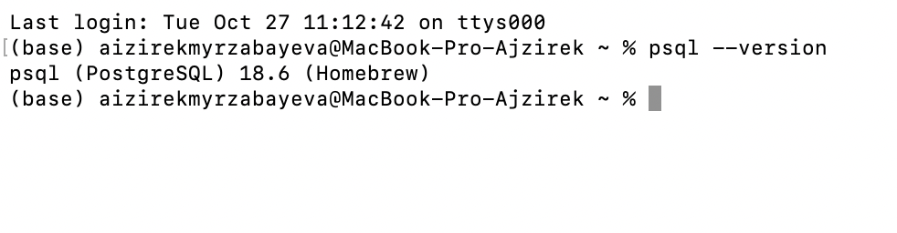
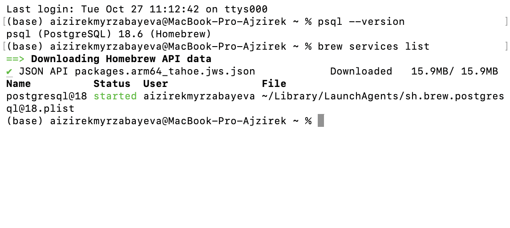
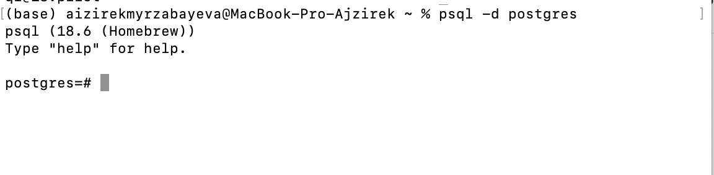
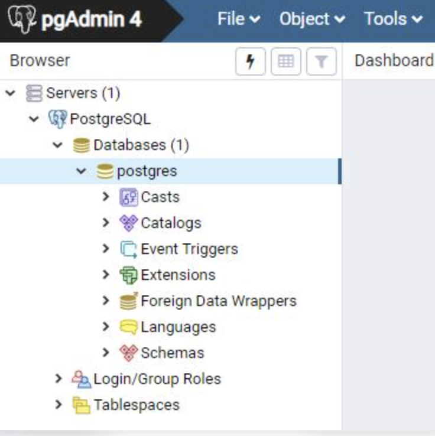

# Lab 02 — Installing PostgreSQL and pgAdmin

**Course:** Database Systems  
**Institution:** American University of Central Asia (AUCA)  
**Student:** Aizirek Myrzabayeva  
**Environment:** macOS, Homebrew, PostgreSQL 18, pgAdmin 4

## 1. Introduction

PostgreSQL is an open-source relational database management system (RDBMS). It stores and manages data, processes SQL queries, and enforces data integrity. **pgAdmin 4** is a graphical administration tool that provides a convenient interface for browsing databases, inspecting database objects, and executing queries.

The purpose of this laboratory is to prepare a working local database environment and verify that PostgreSQL can be accessed through the terminal and, separately, through pgAdmin.

## 2. Learning Objectives

By the end of this exercise, I aim to:

1. Identify the roles of the PostgreSQL server, the `psql` command-line client, and pgAdmin 4.
2. Confirm that PostgreSQL is installed on macOS and check its version.
3. Check the status of the PostgreSQL service managed by Homebrew.
4. Open a connection to a local database through `psql`.
5. Inspect the local PostgreSQL server using pgAdmin 4.
6. Document the environment with clear, genuine screenshots.

## 3. Tools and Environment

| Component | Role in this lab | Environment details |
|---|---|---|
| macOS | Host operating system | Local Mac computer |
| Homebrew | Package and service manager | Used to manage PostgreSQL |
| PostgreSQL | Relational database server | PostgreSQL 18 series |
| `psql` | Command-line client | Version 18.6 observed locally |
| pgAdmin 4 | Graphical administration interface | Installed locally; server connection to be verified |

**PostgreSQL vs. pgAdmin:** PostgreSQL is the database system itself; pgAdmin does not replace the server. It provides another way of connecting to and managing a PostgreSQL installation.

## 4. Setup and Verification

### 4.1. Checking the PostgreSQL Installation

I used the macOS Terminal to check the installed PostgreSQL client version:

```bash
psql --version
```

The environment previously returned:

```text
psql (PostgreSQL) 18.6 (Homebrew)
```

This confirms that the `psql` client is available. It does not, by itself, prove that a database server is running; that is checked separately below.

### 4.2. Checking the PostgreSQL Service

Homebrew can start PostgreSQL as a background service. The following command lists managed services and their status:

```bash
brew services list
```

The previously observed service was `postgresql@18`, with status `started`.

If the service is not running on a future session, it can be started with:

```bash
brew services start postgresql@18
```

This last command is **only needed if the service is stopped**.

### 4.3. Connecting Through `psql`

To test that the server accepts local connections, I used:

```bash
psql -d postgres
```

A successful connection opens the interactive client and shows a prompt such as:

```text
postgres=#
```

The following commands can be used to inspect the connection:

```text
\conninfo
\l
```

- `\conninfo` displays details about the current connection.
- `\l` lists available databases.
- `\q` exits the interactive client.

In earlier work, the local connection successfully opened PostgreSQL 18.6 and accepted database commands.

### 4.4. Opening pgAdmin 4

pgAdmin 4 is installed on this computer. It can be opened from **Applications** or through **Spotlight** (`Command + Space`, then search for `pgAdmin 4`).

After opening pgAdmin, I can inspect the **Servers** section of the Object Explorer on the left. The software may request its master password to unlock previously saved connections.

> The application installation has been confirmed by the student. A screenshot of a live, connected PostgreSQL server in pgAdmin has not yet been added to this report.

### 4.5. Registering or Connecting to the Local Server in pgAdmin

If an existing connection is already listed under **Servers**, open it and expand **Databases**. There is no need to register a duplicate server.

If no server is registered, use **Servers → Register → Server…**. Typical local connection settings are:

| Field | Local configuration |
|---|---|
| Name | Local PostgreSQL (a display label) |
| Host name/address | `localhost` |
| Port | `5432` (the PostgreSQL default) |
| Maintenance database | `postgres` |
| Username | A valid PostgreSQL role for this computer |
| Password | Only if the role's authentication method requires one |

The exact username and authentication method depend on the local PostgreSQL installation. A successful connection should reveal the server's databases in pgAdmin's Object Explorer. **Do not include passwords in screenshots or documentation.**

## 5. Verification Summary

| Check | Observation |
|---|---|
| PostgreSQL client installed | Confirmed: `psql` 18.6 |
| PostgreSQL service running | Confirmed in earlier Terminal output: `postgresql@18` started |
| Local terminal connection | Confirmed: `psql -d postgres` opened successfully |
| pgAdmin 4 installed | Confirmed by student |
| Live pgAdmin server connection | Pending screenshot/verification |

## 6. Output and Screenshots

### 1. PostgreSQL Version


### 2. PostgreSQL Service Status


### 3. PostgreSQL Connection


### 4. pgAdmin Server Connection



## 7. Common Issues and Solutions

| Issue | Explanation / next action |
|---|---|
| `psql: command not found` | The client might not be installed or available on `PATH`. |
| PostgreSQL service is `stopped` | Check `brew services list`; start `postgresql@18` if required. |
| Connection refused | Confirm the server is running and the host/port are correct. |
| pgAdmin does not display a server | Register a server using the correct local connection settings. |
| Authentication failed | Verify the PostgreSQL role and its authentication configuration. Avoid publishing any password. |

## 8. Conclusion

This laboratory establishes the tools needed for the later database exercises. PostgreSQL 18.6 is installed and has been accessed successfully through the terminal; Homebrew reports the database service as running. pgAdmin 4 is also installed. The remaining documentation step is to record the actual pgAdmin server connection and attach the screenshots listed above. Separating the database server, terminal client, and graphical interface helped clarify each tool's responsibility.

## 9. References

- [PostgreSQL documentation — `psql`](https://www.postgresql.org/docs/current/app-psql.html)
- [pgAdmin 4 documentation — Connecting to a Server](https://www.pgadmin.org/docs/pgadmin4/latest/connecting.html)
- [pgAdmin 4 documentation — Server Dialog](https://www.pgadmin.org/docs/pgadmin4/latest/server_dialog.html)
