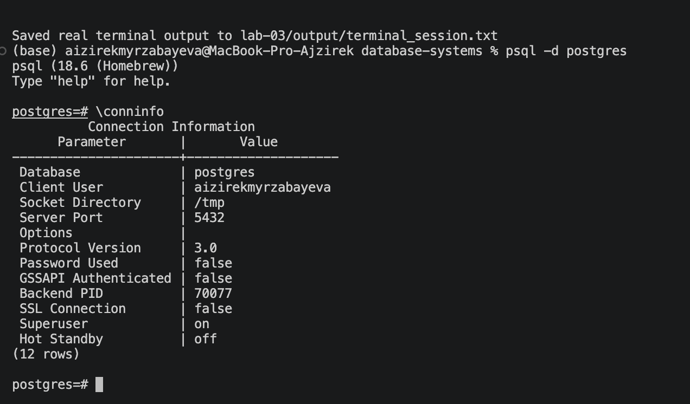
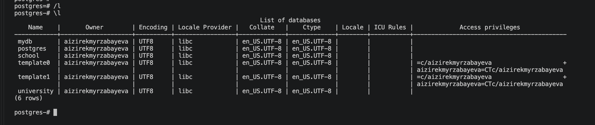
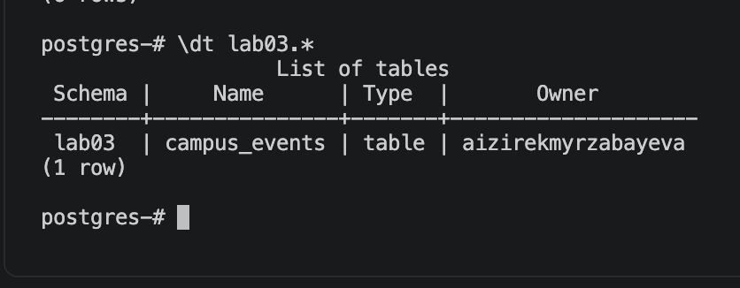
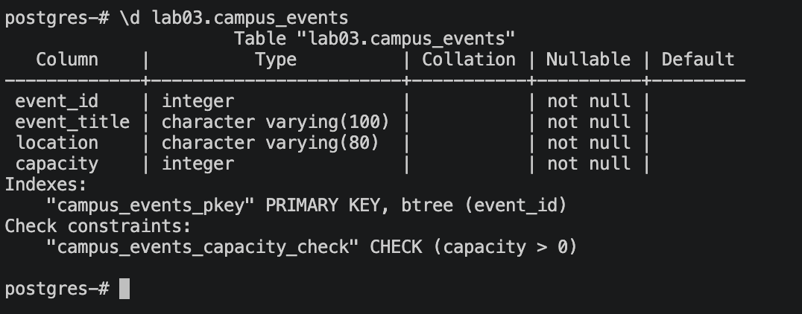
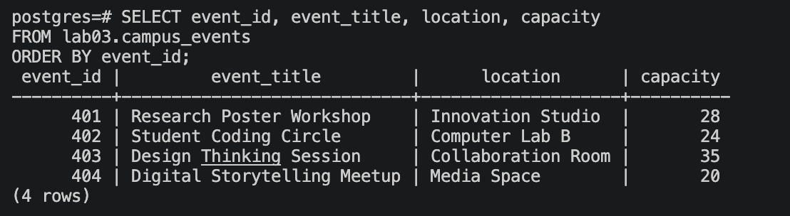

# Lab 03 — Basic `psql` Commands

**Student:** Aizirek Myrzabayeva  
**Student ID:** 11036  
**Course:** Databases — AUCA  
**Environment:** macOS, PostgreSQL 18.6 (Homebrew), `psql` client

## 1. Overview

This laboratory introduces the PostgreSQL interactive terminal, **`psql`**. The main purpose is to learn how to connect to a local PostgreSQL server, inspect available databases, explore tables and schemas, and run a small SQL example. The evidence is collected from commands actually executed on my computer.

## 2. Learning objectives

By the end of this exercise, I should be able to:

1. Launch `psql` and confirm an active connection.
2. Use `psql` meta-commands to list databases, schemas, tables, and table structure.
3. Understand the distinction between a `psql` meta-command and an SQL statement.
4. Execute an `.sql` script from the terminal and inspect its output.
5. Preserve the real terminal session as a text file and screenshots.

## 3. Key concepts

- **PostgreSQL** is the database management system (server).
- **`psql`** is PostgreSQL's interactive command-line client.
- A **meta-command** such as `\l` or `\dt` is interpreted by `psql` and begins with a backslash. Meta-commands do **not** end with a semicolon.
- An **SQL statement** such as `SELECT ...;` is sent to the database server and normally ends with a semicolon.

## 4. PostgreSQL terminal commands

| Command | Purpose |
|---|---|
| `psql --version` | Check the client version in the macOS Terminal |
| `psql -d postgres` | Connect to the local `postgres` database |
| `\conninfo` | Display the active connection details |
| `\l` | List databases |
| `\c postgres` | Connect to the selected database |
| `\dn` | List schemas in the current database |
| `\dt lab03.*` | List tables within the `lab03` schema |
| `\d lab03.campus_events` | Display the columns and constraints of the example table |
| `\timing on` | Display query execution time |
| `\?` | Show help for `psql` commands |
| `\q` | Exit `psql` |

## 5. Implementation

### Step A — Create a small independent sample

I use a fictional **Campus Events** dataset to demonstrate the commands. It is intentionally different from other students' examples and is stored in a separate `lab03` schema to avoid modifying other laboratory data.

From the **root folder of my database-systems repository**, I run:

```bash
psql -d postgres -v ON_ERROR_STOP=1 -f lab-03/lab_03.sql
```

The SQL script creates one example table with these columns:

| Column | Data type | Meaning |
|---|---|---|
| `event_id` | `INTEGER` | Unique primary key |
| `event_title` | `VARCHAR(100)` | Name of the campus event |
| `location` | `VARCHAR(80)` | Location of the event |
| `capacity` | `INTEGER` | Positive number of available places |

All example names and records are fictional. Running the script again updates the same sample IDs rather than adding duplicates.

### Step B — Inspect the database interactively

Start `psql`:

```bash
psql -d postgres
```

Then run these commands **one by one** at the `postgres=#` prompt:

```text
\conninfo
\l
\c postgres
\dn
\dt lab03.*
\d lab03.campus_events
\timing on
SELECT event_id, event_title, location, capacity
FROM lab03.campus_events
ORDER BY event_id;
\q
```

The `\dt` command confirms that the example table exists, `\d` shows its structure, and `SELECT` displays the inserted records. `\timing on` enables timing output for the SQL query.

### Step C — Save a real terminal log

For a reproducible output file, the included `capture_lab03.sh` script runs the example and the inspection commands, then saves their **actual output**:

```bash
zsh lab-03/capture_lab03.sh
```

The resulting file is `output/terminal_session.txt`. The script does **not** fabricate PostgreSQL output. It also does not delete any databases or other lab folders.

## 6. Results and screenshots

Screenshots should be captured from **my own macOS Terminal** while running the commands above. They are not included in the starter package.


## 6. Results and Screenshots

This section documents the execution of PostgreSQL commands using the `psql` command-line interface on macOS.

All screenshots were captured from my local PostgreSQL environment. The full terminal output is also preserved for verification.

### 6.1 PostgreSQL Connection

The `\conninfo` command displays information about the active PostgreSQL connection, including the database, user, and connection details.



### 6.2 Listing Available Databases

The `\l` command displays all databases available on the PostgreSQL server, including their owners and encoding information.



### 6.3 Listing Tables

The `\dt lab03.*` command displays the tables created within the `lab03` schema.



### 6.4 Inspecting Table Structure

The `\d lab03.campus_events` command displays the table's columns, data types, primary key, and constraints.



### 6.5 Executing a SQL Query

The following query retrieves the event records stored in the sample table:

```sql
SELECT event_id, event_title, location, capacity
FROM lab03.campus_events
ORDER BY event_id;
```

The query returns four fictional campus events, demonstrating successful data retrieval using PostgreSQL.



### 6.6 Terminal Session Output

A complete record of the executed PostgreSQL commands and their actual results is available here:

[View Terminal Session Output](output/terminal_session.txt)

The terminal log provides additional verification of the database connection, schema inspection, table structure, and query execution.


The full text-based output will be saved in [`output/terminal_session.txt`](output/terminal_session.txt) when I run the capture script.

## 7. Verification

This lab is ready for final review when:

- The terminal commands execute successfully on my local PostgreSQL server.
- `\dt lab03.*` lists `lab03.campus_events`.
- `\d lab03.campus_events` shows `event_id` as the primary key.
- The sample `SELECT` query returns four event records.
- The saved terminal log and five screenshots match the commands and results.

## 8. Conclusion

This exercise is designed to demonstrate practical navigation in PostgreSQL using the `psql` terminal client. In particular, it distinguishes interactive `psql` meta-commands from SQL statements and records the structure and contents of a small independent example database table.

**Status:** Prepared for local execution and evidence collection; no execution results are claimed until the commands are run on my Mac.

## References

- [PostgreSQL documentation — psql](https://www.postgresql.org/docs/current/app-psql.html)
- [PostgreSQL documentation — SQL syntax](https://www.postgresql.org/docs/current/sql-syntax.html)
