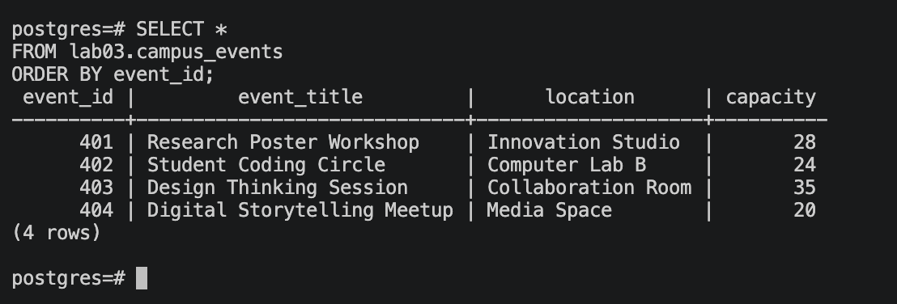
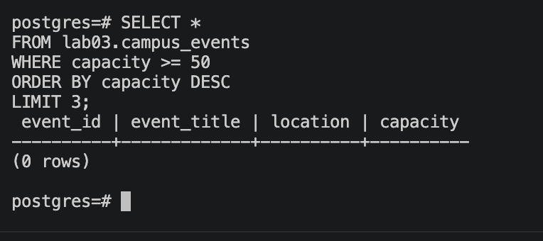

# Lab 04 — First SQL Query

**Course:** Database Systems  
**Student:** Aizirek Myrzabayeva  
**Environment:** macOS · PostgreSQL 18.6 · `psql`  
**Source data:** the **Campus Events** table prepared in [Lab 03](../lab-03/README.md)

## 1. Overview

This laboratory demonstrates introductory SQL `SELECT` statements using an existing relational table. Instead of creating a different dataset, I continue working with the fictional campus-event records from Lab 03. This keeps the laboratory exercises connected and makes it easier to compare different query results.

## 2. Objectives

- Retrieve every column and row with `SELECT *`.
- Retrieve selected columns rather than an entire record.
- Filter data using `WHERE`.
- Sort query results using `ORDER BY` with `ASC` and `DESC`.
- Restrict the number of returned records using `LIMIT`.
- Inspect real query results in PostgreSQL's `psql` interface.

## 3. Dataset and prerequisites

The examples use `lab03.campus_events` from Lab 03. Its columns are `event_id`, `event_title`, `location`, and `capacity`.

| event_id | event_title | location | capacity |
| ---: | --- | --- | ---: |
| 401 | Research Poster Workshop | Innovation Studio | 28 |
| 402 | Student Coding Circle | Computer Lab B | 24 |
| 403 | Design Thinking Session | Collaboration Room | 35 |
| 404 | Digital Storytelling Meetup | Media Space | 20 |

*All records are fictional and created solely for learning.*

> **Prerequisite:** Lab 03 must already have created and populated `lab03.campus_events` in the local `postgres` database. This Lab 04 script only queries that table; it does not alter the underlying data.

## 4. Implementation and results

The eight queries are saved in [`lab04.sql`](lab04.sql).

| Query | Purpose | Expected result with the Lab 03 dataset |
| --- | --- | --- |
| `SELECT * ... ORDER BY event_id` | Display all columns | 4 rows |
| `SELECT event_title, location ... ORDER BY event_title ASC` | Choose columns and sort alphabetically | 4 rows |
| `SELECT event_id, capacity` | Return two fields | 4 rows |
| `WHERE event_title = 'Student Coding Circle'` | Match one specific event | 1 row |
| `WHERE capacity >= 25` | Filter by capacity | 2 rows |
| `ORDER BY event_title DESC` | Reverse alphabetical order | 4 rows |
| `ORDER BY event_id LIMIT 2` | Restrict result to two rows | 2 rows |
| `ORDER BY capacity ASC, event_title ASC LIMIT 3` | Find the three smallest-capacity events | 3 rows |

The expected row counts above are derived from the sample dataset. The **actual executed output** should be saved from my local PostgreSQL session before submission.

### 4.1 Selecting all records

```sql
SELECT *
FROM lab03.campus_events
ORDER BY event_id;
```

`SELECT *` returns every column in the table. `ORDER BY event_id` makes the display order predictable.

### 4.2 Filtering with `WHERE`

```sql
SELECT event_title, location, capacity
FROM lab03.campus_events
WHERE capacity >= 25
ORDER BY capacity DESC;
```

This query shows only events with capacity of at least 25 and sorts them from highest capacity to lowest.

### 4.3 Sorting and limiting

```sql
SELECT event_title, capacity, location
FROM lab03.campus_events
ORDER BY capacity ASC, event_title ASC
LIMIT 3;
```

`ORDER BY` determines which events appear first; `LIMIT 3` then keeps only the first three. Adding `event_title` as a second sort key makes the order consistent when capacities are tied.

## 5. Execution

Open Terminal in VS Code at the root of `database-systems` and run:

```bash
mkdir -p lab-04/output/screenshots
psql -X -a -v ON_ERROR_STOP=1 -P pager=off -d postgres -f lab-04/lab04.sql 2>&1 | tee lab-04/output/psql-session.txt
```

The first command ensures the output folder exists. The second runs all eight queries and saves their **real output** as [`output/psql-session.txt`](output/psql-session.txt).

If PostgreSQL reports that `lab03.campus_events` does not exist, run the Lab 03 SQL file first (`psql -d postgres -v ON_ERROR_STOP=1 -f lab-03/lab_03.sql`) and then rerun Lab 04.

## 6. Screenshots and terminal output

Two screenshots document the executed results, following the concise format of the laboratory examples. **These images must be taken from the real local PostgreSQL session.**

### 6.1 First `SELECT` query

Show the output for the query returning all four event records.



### 6.2 Filtering, sorting and limiting

Show results for `WHERE capacity >= 25`, `ORDER BY event_title DESC`, and `ORDER BY capacity ASC ... LIMIT 3`. More than one terminal screenshot can be used if needed to keep the text readable.



**Full terminal session:** [psql-session.txt](output/psql-session.txt)

*Screenshot links will display images after the actual files are added to `output/screenshots/`. No screenshots or query results have been fabricated.*

## 7. Discussion

Each returned row represents one event record, while each column shows one selected field. `SELECT *` retrieves all four fields; selecting explicit columns returns only the information needed. `WHERE` restricts records to those matching a condition. `ORDER BY` sorts the output, and `LIMIT` keeps a specified number of rows after sorting. SQL comments (`--` and `/* ... */`) explain the queries but do not affect their results.

## 8. Conclusion

This lab introduces the most common ways of retrieving and examining database records with SQL. It builds on the sample table from Lab 03 and demonstrates how small changes to a `SELECT` query affect which columns and rows are displayed. The complete results can be verified with the saved `psql` log and screenshots.

## 9. References

- [PostgreSQL 18 Documentation — SELECT](https://www.postgresql.org/docs/18/sql-select.html)
- [PostgreSQL Documentation — psql](https://www.postgresql.org/docs/18/app-psql.html)
