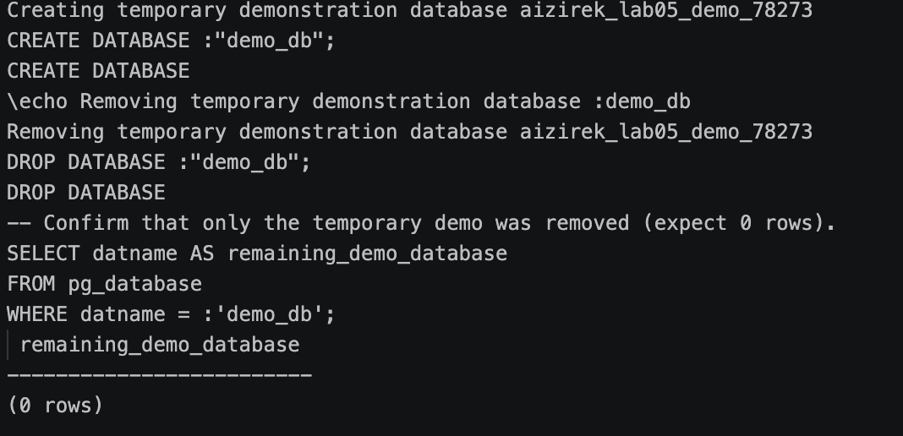
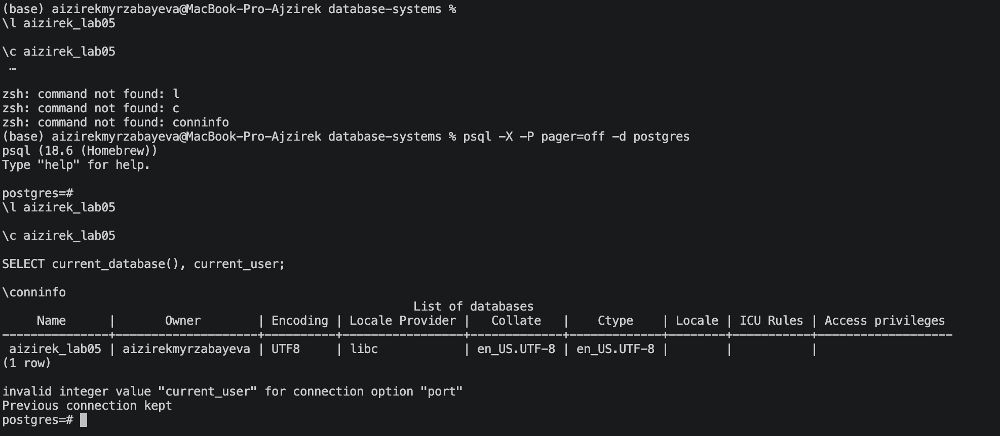

# Lab 05 — Databases

**Student:** Aizirek Myrzabayeva  
**Course:** Database Systems, AUCA  
**Environment:** macOS, PostgreSQL 18 (Homebrew), `psql`

## Objective

Practice PostgreSQL database-level operations: creating a database, displaying available databases, changing the active connection, checking connection details, and safely deleting a temporary demonstration database.

## Tasks and Commands

| Step | Command / feature | Purpose |
| --- | --- | --- |
| 1 | `CREATE DATABASE` | Create `aizirek_lab05` if it is absent. |
| 2 | `CREATE DATABASE` / `DROP DATABASE` | Create and remove a uniquely named *temporary demonstration database*. |
| 3 | `\l aizirek_lab05` | Display the practice database in the database list. |
| 4 | `\connect aizirek_lab05` | Switch the current `psql` connection to the practice database. |
| 5 | `SELECT current_database(), current_user` | Verify the active database and logged-in database user. |
| 6 | `\conninfo` | Display connection details. |

## SQL Script

The script is in [`lab05.sql`](lab05.sql). The practice database name is `aizirek_lab05`; it is deliberately different from the other laboratory databases.

```sql
SELECT current_database() AS connected_database,
       current_user AS connected_user;
```

To avoid destroying any coursework, the script **keeps `aizirek_lab05`** after completion. Only the database with the generated name `aizirek_lab05_demo_<backend_pid>` is dropped. `DROP DATABASE` permanently deletes the named database and its contents, so it must be used carefully.

The `\l` and `\connect` commands belong to the PostgreSQL **psql client**; they are not standard SQL queries. The script starts in `postgres`, because the target database cannot be dropped while connected to it, and database creation/deletion cannot be run inside a transaction block.

## Execution

From the root of the `database-systems` repository:

```bash
zsh lab-05/capture_lab05.sh
```

The helper script runs `lab05.sql` using the current local PostgreSQL user and saves the **actual** terminal output in [`output/psql-session.txt`](output/psql-session.txt). It stops if PostgreSQL reports an error. The script can be rerun; it will not recreate or delete the permanent database if it already exists.

Alternatively, run the SQL directly:

```bash
psql -X -a -v ON_ERROR_STOP=1 -P pager=off -d postgres -f lab-05/lab05.sql
```

## Results and Screenshots

### 1. Database Creation and Safe Deletion

The terminal output demonstrates creating and dropping only the temporary demonstration database. It also verifies that the temporary database no longer exists.



### 2. Database List and Connection Verification

The database list displays `aizirek_lab05`. After connecting to it, `current_database()` returns the practice database name and `current_user` identifies the locally connected PostgreSQL user.



### Full Terminal Session

[View actual PostgreSQL output](output/psql-session.txt).

**Evidence note:** The screenshots and terminal log are produced on the local computer; they are not simulated or included in advance.

## Conclusion

This lab demonstrates the distinction between database administration commands and queries that inspect the current connection. Creating, listing, connecting to, and safely removing a disposable PostgreSQL database can be completed through the `psql` command-line interface.
