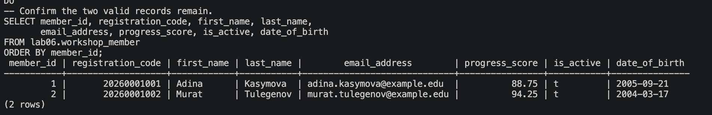
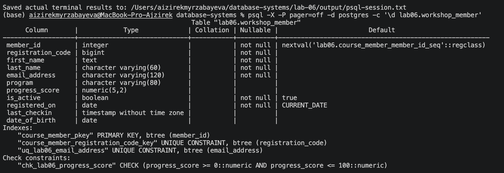
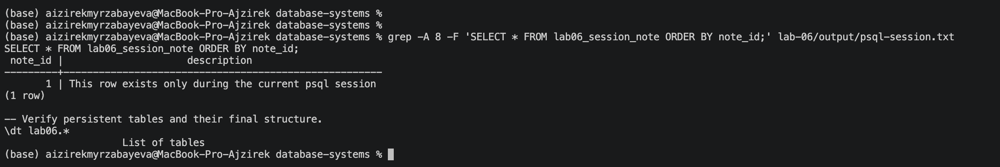

# Lab 06 — Tables, Data Types and Constraints

**Student:** Aizirek Myrzabayeva  
**Course:** Database Systems — AUCA  
**Database system:** PostgreSQL 18 (macOS / `psql`)  
**Exercise data:** Fictional campus workshop participants

## Objective

The goal of this laboratory is to define a relational table with appropriate column types and constraints, modify its structure using `ALTER TABLE`, safely remove a disposable table, and inspect the differences between persistent and temporary tables. The examples are contained in the `lab06` schema so that other laboratories are not affected.

## 1. Table creation and data types

I created `lab06.course_member` with two original sample records. Its columns demonstrate several PostgreSQL data types:

| Type | Use in the example |
| --- | --- |
| `SERIAL` | Automatically generated `member_id` |
| `INTEGER` | Whole numbers, including temporary table IDs |
| `BIGINT` | Long numeric registration codes |
| `VARCHAR(n)` | Names, email addresses and program names with maximum lengths |
| `TEXT` | Optional notes, later removed with `ALTER TABLE` |
| `NUMERIC(5,2)` | Two-decimal-place workshop progress scores |
| `BOOLEAN` | `is_active`, defaulting to `TRUE` |
| `DATE` | Registration and birth dates |
| `TIMESTAMP` | Last check-in date and time |

I use lowercase `snake_case` identifiers consistently. All example names and emails are fictional.

## 2. Constraints and validation

The table uses a **primary key** to identify each member, **NOT NULL** to require essential fields, **UNIQUE** to prevent repeated email addresses and registration codes, and **CHECK** to restrict progress scores to values from 0 to 100. A foreign key represents a relationship between tables; this concept is introduced in the course document and will be demonstrated in detail in Lab 08.

Three deliberately invalid inserts are attempted inside exception-handling blocks. PostgreSQL must reject them, and the script reports the expected result:

| Test | Expected behavior |
| --- | --- |
| Duplicate email address | `UNIQUE` rejects the row |
| Progress score of 125 | `CHECK` rejects the row |
| Missing first name (`NULL`) | `NOT NULL` rejects the row |

These failures are **intentional tests**, not unfinished SQL errors. The two original records remain in the final table. Since progress scores are optional, a `NULL` score is allowed unless a `NOT NULL` constraint is added.

## 3. Modifying a table with `ALTER TABLE`

The script demonstrates the main schema-change operations from the course document:

1. **ADD COLUMN** — add `date_of_birth` and populate the dates.
2. **DROP COLUMN** — remove the optional `notes` column.
3. **ALTER COLUMN TYPE** — change `first_name` from `VARCHAR(40)` to `TEXT`.
4. **ADD / DROP CONSTRAINT** — replace the email constraint with the named `uq_lab06_email_address` constraint, and add a score check.
5. **RENAME COLUMN / TABLE** — rename `email` to `email_address` and `course_member` to `workshop_member`.

The final persistent table is therefore `lab06.workshop_member`.

## 4. Dropping and temporary tables

I created and removed a separate disposable table using `DROP TABLE`. I also demonstrated that dropping a nonexistent table raises an error without `IF EXISTS`, whereas `DROP TABLE IF EXISTS` avoids that error. **No table from another lab is removed.**

A session-local temporary table, `lab06_session_note`, contains a single record. Its contents are displayed during the script run. PostgreSQL automatically removes this temporary table when the `psql` session ends.

## 5. Run the laboratory

From the root of the `database-systems` repository, run:

```bash
zsh lab-06/capture_lab06.sh
```

The shell script runs `psql-demo.sql`, which includes the original queries in `lab06.sql`. The command uses `ON_ERROR_STOP=1`, disables pagination and saves **actual PostgreSQL output** to [`output/psql-session.txt`](output/psql-session.txt).

**Repeat-run behavior:** the script recreates only the two example table names under the `lab06` schema. Do not store unrelated information in those tables. It does not reset other schemas or databases.

## 6. Results and screenshots

### 6.1 Constraint verification and final records

The terminal log should show `PASS` notices for the duplicate email, invalid score and missing name tests, followed by the two valid workshop members.



### 6.2 Final table structure

The `\d lab06.workshop_member` command shows the final column types, primary key, unique constraints, check constraint and column modifications.



### 6.3 Temporary table demonstration

The recorded SQL session shows a temporary table with one row. Because it is session-specific, the example needs to be captured while that session is running, or from the preserved terminal output.



### Complete terminal output

[View the saved PostgreSQL session](output/psql-session.txt)

*The images and terminal log above will be available after the SQL is executed on the student's Mac and real screenshots are saved. They are not simulated results.*

## 7. Conclusion

This exercise demonstrates that PostgreSQL data types define how information is stored, while constraints enforce rules about which values are acceptable. `ALTER TABLE` can evolve an existing schema, `DROP TABLE` removes a specified persistent table, and temporary tables keep session-specific data separate from permanent tables.

## Files

- [`lab06.sql`](lab06.sql) — original example data and SQL operations.
- [`psql-demo.sql`](psql-demo.sql) — `psql` entry point.
- [`capture_lab06.sh`](capture_lab06.sh) — saves real terminal output.
- [`output/`](output/) — terminal log and screenshots captured locally.

**Course document:** [Lab 6 — Tables, Data Types and Constraints](https://drive.google.com/file/d/1VbzMZLRlmZaGdtf2FBgx3tjAhQRSBaNU/view)
