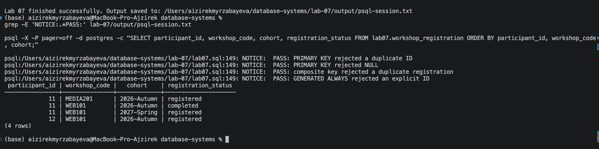
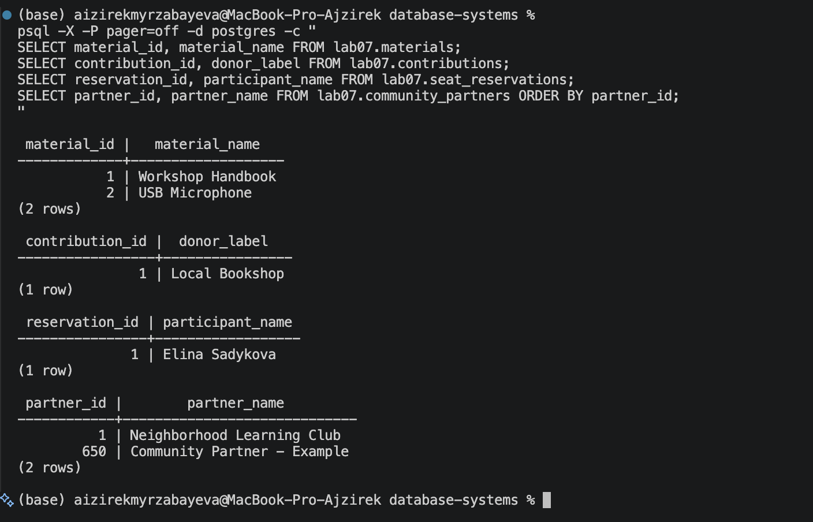

# Lab 07 — Primary Keys

**Course:** Database Systems (AUCA)  
**Student:** Aizirek Myrzabayeva  
**Environment:** PostgreSQL 18, `psql`, macOS  
**Example:** Fictional community workshop records

## Objective

Practice creating and checking primary keys, including single-column and composite keys. Demonstrate how PostgreSQL rejects duplicate and `NULL` primary-key values, creates indexes, and generates identifiers with `SERIAL`, `BIGSERIAL`, and `IDENTITY`.

A **primary key** uniquely identifies each row. Its columns cannot contain `NULL`; a table may have **one** primary-key constraint, including one composed of multiple columns. In normal database design, primary-key values should remain stable after assignment. They can later be referenced by foreign keys in related tables.

## Primary-key declarations

| Technique | Implemented in | Explanation |
| --- | --- | --- |
| Inline column constraint | `lab07.column_key` | `mentor_id INTEGER PRIMARY KEY` |
| Table-level constraint | `lab07.table_key` | `PRIMARY KEY (workshop_id)` |
| Explicitly named constraint | `lab07.named_key` | `CONSTRAINT pk_learning_center PRIMARY KEY (center_id)` |
| Added to an existing table | `lab07.added_key` | `ALTER TABLE ... ADD CONSTRAINT ... PRIMARY KEY` |

The same schema includes `lab07.workshop_registration`, whose composite key is `(participant_id, workshop_code, cohort)`. It accepts registration for the same workshop in different cohorts but rejects the same participant–workshop–cohort combination twice.

## Automatically generated IDs

| Mechanism | Table | Behavior |
| --- | --- | --- |
| `SERIAL` | `lab07.materials` | Sequence-generated integer |
| `BIGSERIAL` | `lab07.contributions` | Sequence-generated 64-bit integer |
| `GENERATED ALWAYS AS IDENTITY` | `lab07.seat_reservations` | Normally rejects user-supplied IDs |
| `GENERATED BY DEFAULT AS IDENTITY` | `lab07.community_partners` | Accepts a manually specified ID or generates one |

Identity columns and serial columns are **not sufficient on their own** to enforce uniqueness: each example also declares `PRIMARY KEY`. PostgreSQL automatically creates a unique B-tree index for each primary key.

## Verification

The SQL script deliberately tests four invalid insertions using caught exceptions:

1. A duplicate single-column key.
2. A `NULL` primary-key value.
3. A duplicate composite-key combination.
4. An explicit ID inserted into `GENERATED ALWAYS AS IDENTITY` without an override.

When PostgreSQL rejects these attempts as expected, the script prints `PASS` notices and continues. The queries also display saved registrations, generated IDs, `pg_indexes`, and `\d` table descriptions. Actual results are captured in the terminal log.

## Running the lab

From the root of the `database-systems` repository:

```bash
zsh lab-07/capture_lab07.sh
```

This script runs `psql-demo.sql`, which loads `lab07.sql`, and saves the real results as [`output/psql-session.txt`](output/psql-session.txt). You may also run it directly with:

```bash
psql -X -a -v ON_ERROR_STOP=1 -P pager=off -d postgres -f lab-07/psql-demo.sql
```

**Rerun behavior:** `lab07.sql` begins with `DROP SCHEMA IF EXISTS lab07 CASCADE` followed by `CREATE SCHEMA lab07`. It replaces **all contents of schema `lab07`**, but does not drop other schemas or databases. Do not use the script if `lab07` contains anything you want to keep.

## Results and screenshots

### 1. Primary-key checks and composite registration

The command output shows `PASS` notices for duplicate and null primary keys, a repeated registration, and an explicit `GENERATED ALWAYS` ID. The composite-key query demonstrates that a participant can attend the same workshop in another cohort.



### 2. Generated IDs and key structure

The second screenshot shows the resulting IDs from `SERIAL`, `BIGSERIAL`, `IDENTITY ALWAYS`, and `IDENTITY BY DEFAULT`. The complete terminal log also contains `\d` table descriptions and `pg_indexes` results documenting the primary-key indexes.



**Full Terminal session:** [psql-session.txt](output/psql-session.txt)  
**SQL:** [lab07.sql](lab07.sql)  
**Course material:** [Lab 7 — Primary Keys](https://drive.google.com/file/d/1dDxnTfpofoXS5KFv2CgsM0r8ZP03imXZ/view)  
**PostgreSQL reference:** [Identity columns](https://www.postgresql.org/docs/18/ddl-identity-columns.html)

> Screenshots and the terminal log must be captured from the actual PostgreSQL run; no simulated output has been included.

## Conclusion

This lab demonstrates four ways to declare a primary key, the distinction between single and composite keys, automatic identifier generation, and enforcement of uniqueness and non-null values. The results also show how PostgreSQL uses a unique index to support each primary-key constraint.
