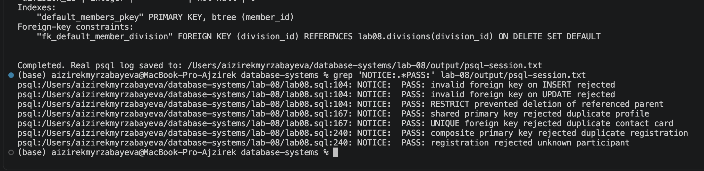
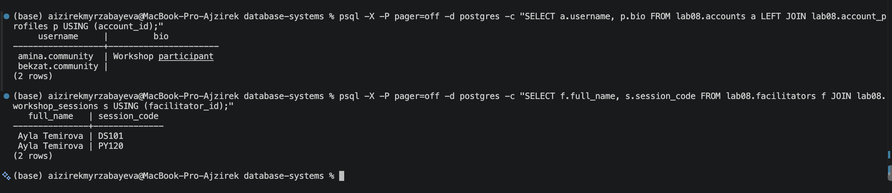
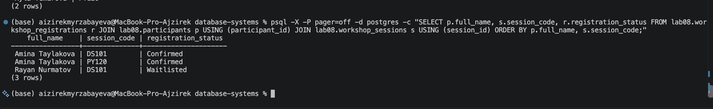

# Lab 08 — Foreign Keys and Relationships

**Student:** Aizirek Myrzabayeva  
**Course:** Database Systems  
**Environment:** PostgreSQL 18, `psql`, macOS  
**Project:** Community Workshop Network (fictional learning data)

## 1. Objective

This laboratory demonstrates **foreign keys** and **referential integrity**. I used four ways to declare foreign-key constraints, tested actions on parent-row deletion or updates, and modeled **one-to-one (1:1)**, **one-to-many (1:N)**, and **many-to-many (N:M)** relationships.

All database objects belong to the `lab08` schema, so this example does not depend on or modify other labs. **Rerunning the script drops and recreates `lab08` and all its contents.**

## 2. Foreign keys and referential integrity

A foreign key connects a column in a child table to a key in a parent table. PostgreSQL rejects child references that do not exist in the parent table, helping prevent orphaned records.

I practiced these ways of defining a foreign key:

| Approach | Example in this lab |
| --- | --- |
| Inline declaration | `restrict_members.division_id` |
| Table-level declaration | `cascade_members.division_id` |
| Named constraint | `nullable_members.division_id` |
| Added with `ALTER TABLE` | `default_members.division_id` |

The script intentionally attempts an `INSERT` and an `UPDATE` with an unknown `division_id`. Both operations should be rejected and reported as `PASS` notices.

## 3. Referential actions

A fictional **division** table provides parent rows. Separate child tables demonstrate the effects of each constraint without interfering with one another.

| Action | Expected result |
| --- | --- |
| `ON DELETE RESTRICT` | A referenced division cannot be deleted. |
| `ON DELETE CASCADE` | Its child record is deleted. |
| `ON DELETE SET NULL` | The child remains and its division becomes `NULL`. |
| `ON DELETE SET DEFAULT` | The child remains and its division becomes `0` (`Unassigned`). |
| `ON UPDATE CASCADE` | A child follows the parent's changed ID, `50` → `55`. |
| Combined update/delete cascade | A child follows `60` → `66`, then disappears when `66` is deleted. |

**Important distinction:** the default PostgreSQL referential action is `NO ACTION`, not `RESTRICT`. This lab explicitly tests `RESTRICT`. `SET DEFAULT` is valid only if the default value also satisfies the foreign-key constraint; here division `0` exists.

## 4. Types of relationships

### One-to-one (1:1)

The table `accounts` has two alternative profile designs:

- `account_profiles` uses a **shared primary key**, which is also a foreign key to `accounts`.
- `account_contact_cards` uses an independent primary key and an additional **`UNIQUE NOT NULL` foreign key**.

Both prevent a second profile/card for the same account. An account can still exist without either record. The script checks both duplicate violations.

### One-to-many (1:N)

One facilitator, **Ayla Temirova**, is connected to two workshop sessions: `DS101` (Digital Citizenship) and `PY120` (Python for Beginners). Each session belongs to one facilitator.

### Many-to-many (N:M)

The junction table `workshop_registrations` links participants and sessions using two foreign keys. The composite primary key `(participant_id, session_id)` prevents duplicate registrations for the same session.

The fictional data contains **two participants and three registrations**. SQL queries show all registrations, both participants attending `DS101`, and both sessions selected by Amina Taylakova.

## 5. Running the laboratory

From the `database-systems` repository root in VS Code Terminal:

```bash
zsh lab-08/capture_lab08.sh
```

Or directly with `psql`:

```bash
psql -X -a -v ON_ERROR_STOP=1 -P pager=off -d postgres -f lab-08/psql-demo.sql
```

The shell script records the **actual PostgreSQL session** in [`output/psql-session.txt`](output/psql-session.txt). The log is generated locally, not prefilled with simulated command results. PostgreSQL `NOTICE` messages marked `PASS` indicate that expected invalid operations were correctly rejected.

## 6. Results and screenshots

The two sections below should show screenshots captured after running the scripts on my local PostgreSQL installation.

### 6.1 Foreign-key actions and constraint checks

The screenshot includes the expected failure checks and the final effects of `RESTRICT`, `CASCADE`, `SET NULL`, `SET DEFAULT`, and `ON UPDATE CASCADE`.



### 6.2 One-to-one and one-to-many relationships

Two account/profile designs are verified, alongside the sessions linked to one facilitator.



### 6.3 Many-to-many workshop registrations

The junction table records three valid registrations and rejects a repeated `(participant_id, session_id)` combination.



**Full run:** [View actual PostgreSQL output](output/psql-session.txt)  
**SQL:** [lab08.sql](lab08.sql)  
**Reproducible commands:** [psql-demo.sql](psql-demo.sql) · [capture_lab08.sh](capture_lab08.sh)  
**Course document:** [Foreign Keys and Relationships](https://drive.google.com/file/d/1HLQfBeDeBlFqEo0Z8jtA9E8YW-AmAQfw/view)

## 7. Conclusion

This lab illustrates how foreign keys preserve relationships between tables and how referential actions affect dependent rows. The `1:1`, `1:N`, and `N:M` examples show how common relationship types are represented using foreign keys, uniqueness, and a junction table. Final results should be checked against the captured terminal session after executing the lab.
