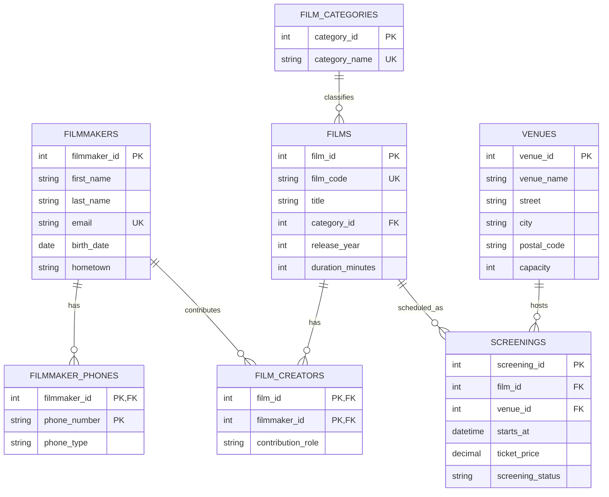
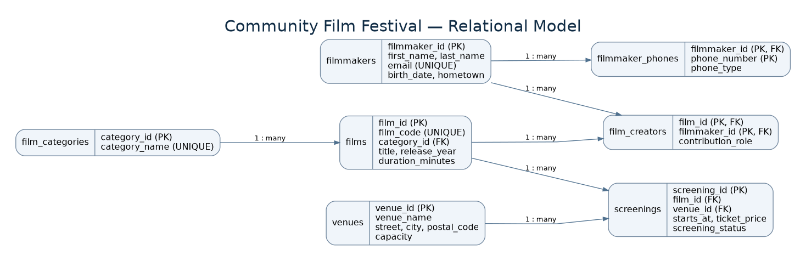
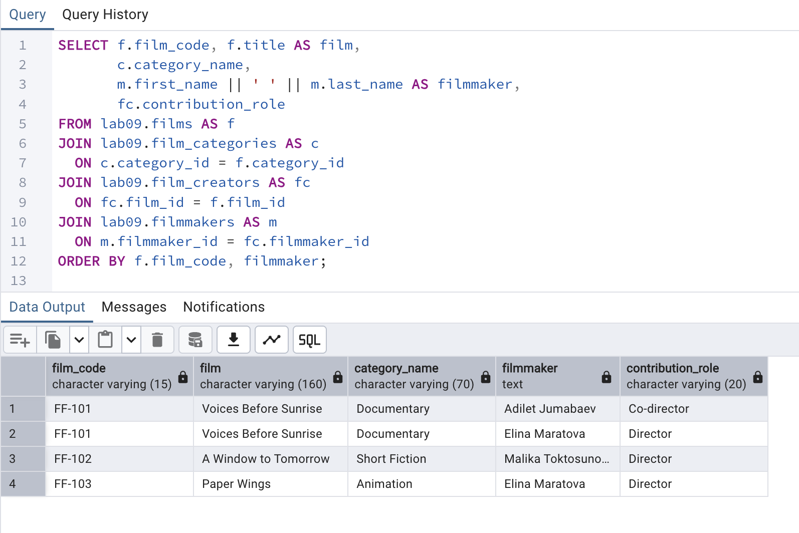
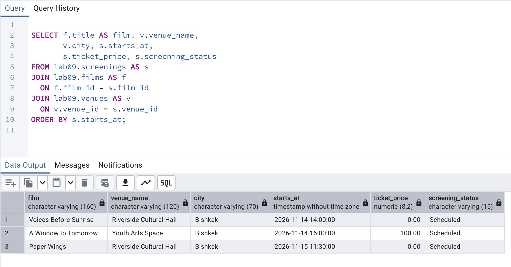

# Lab 09 — Database Design Basics

**Course:** Database Systems  
**Student:** Aizirek Myrzabayeva  
**DBMS:** PostgreSQL 18  
**Case study:** Community Film Festival (fictional sample data)

## 1. Overview

For this laboratory, I designed a normalized relational database for a small community film festival. The system stores filmmakers, their contact numbers, films, film categories, venues, and screening schedules. A film may have multiple creators, and each creator may work on several films. A film may be screened more than once, at different venues.

The workflow follows the database design process: **requirements analysis → conceptual ER model → logical tables and keys → normalization → PostgreSQL implementation → verification**. The sample names, contact details, venues, and films are fictional.

## 2. Requirements analysis

The database should:

1. Track filmmakers and allow more than one phone number for each filmmaker.
2. Record films and their categories without repeatedly storing category descriptions.
3. Support co-directed films and creators who work on several films.
4. Store venues using separate street, city, and postal-code fields.
5. Record multiple screenings per film, including date/time and admission price.
6. Enforce valid links through primary and foreign keys.

## 3. ER modeling

**Entities** are independent concepts such as `film`, `filmmaker`, and `venue`. **Attributes** are fields such as `title`, `first_name`, and `starts_at`. **Relationships** connect those entities: a filmmaker contributes to films, a venue hosts screenings, and each film belongs to one category.

### Attribute classification

| Type | Example in this design | Explanation |
| --- | --- | --- |
| Simple | `first_name`, `film_code` | Stored as an individual value |
| Composite | Venue address → `street`, `city`, `postal_code` | Broken into searchable components |
| Derived | Age from `birth_date` | Calculated at query time rather than stored |
| Key | `filmmaker_id`, `film_id` | Uniquely identifies a row |
| Multivalued | Filmmaker phone numbers | Modeled as separate rows in `filmmaker_phones` |

### Entity–relationship diagram



A separate rendered diagram is also provided for easy viewing:



### Relationship types

| Relationship | Cardinality | Database implementation |
| --- | --- | --- |
| Category → Film | 1:N | `films.category_id` references `film_categories` |
| Filmmaker ↔ Film | N:M | `film_creators` has two foreign keys and a composite primary key |
| Filmmaker → Phone number | 1:N | One phone-number value in each `filmmaker_phones` row |
| Film → Screening | 1:N | `screenings.film_id` references `films` |
| Venue → Screening | 1:N | `screenings.venue_id` references `venues` |

## 4. Normalization (1NF, 2NF, 3NF)

**First Normal Form (1NF):** Instead of a field such as `"DEMO-MOBILE-001, DEMO-HOME-001"`, each phone number appears in its own row in `filmmaker_phones`. The table has a composite key `(filmmaker_id, phone_number)`.

**Second Normal Form (2NF):** The junction table `film_creators` has the composite key `(film_id, filmmaker_id)`. Its `contribution_role` applies to that *entire combination*. Film titles are stored in `films`, and filmmaker names are stored in `filmmakers`, rather than repeated in the junction table.

**Third Normal Form (3NF):** `films` stores `category_id`, not `category_name` or its description. Category details belong in `film_categories`, so updating a category name does not require changing every film. Venue location fields are stored with the venue instead of being copied into each screening.

These design decisions reduce redundancy and prevent update anomalies.

## 5. Logical and physical database design

The SQL script creates **seven tables** in the `lab09` schema: `filmmakers`, `filmmaker_phones`, `film_categories`, `films`, `film_creators`, `venues`, and `screenings`.

PostgreSQL types include `INTEGER GENERATED ALWAYS AS IDENTITY`, `VARCHAR`, `DATE`, `TIMESTAMP`, and `NUMERIC(8,2)`. `PRIMARY KEY`, `FOREIGN KEY`, `UNIQUE`, `NOT NULL`, and `CHECK` constraints protect data integrity. Indexes on frequently joined foreign keys help typical lookup queries.

The model uses a **composite primary key** in `film_creators` to prevent registering the same filmmaker twice on the same film. A screening's `(film_id, venue_id, starts_at)` combination is also unique.

## 6. Execution

From the repository root (`database-systems`), run:

```bash
zsh lab-09/capture_lab09.sh
```

The script executes `psql-demo.sql`, which loads `lab09.sql`, runs demonstration queries, and shows table definitions. Real console output is written to [`output/psql-session.txt`](output/psql-session.txt).

> **Rerun warning:** `lab09.sql` starts by dropping and recreating the **`lab09` schema only**. It does not delete other laboratory schemas or databases. Any existing data inside `lab09` will be replaced.

## 7. Results and screenshots

The sample queries display film credits (including a film with two creators), venue screening schedules, individual phone-number rows, and ages calculated from birth dates. The terminal log includes the final table and constraint definitions.

### Screenshot 1 — Films and creators in pgAdmin

Run the film-credit query below in pgAdmin Query Tool, capture the SQL and Data Output, and save the screenshot as `output/screenshots/01-pgadmin-film-creators.png`.

```sql
SELECT f.film_code, f.title AS film, c.category_name,
       m.first_name || ' ' || m.last_name AS filmmaker, fc.contribution_role
FROM lab09.films AS f
JOIN lab09.film_categories AS c ON c.category_id = f.category_id
JOIN lab09.film_creators AS fc ON fc.film_id = f.film_id
JOIN lab09.filmmakers AS m ON m.filmmaker_id = fc.filmmaker_id
ORDER BY f.film_code, filmmaker;
```



### Screenshot 2 — Film screening schedule in pgAdmin

Run the following query in pgAdmin Query Tool. Capture the SQL and Data Output and save it as `output/screenshots/02-pgadmin-screenings.png`.

```sql
SELECT f.title AS film, v.venue_name, v.city,
       s.starts_at, s.ticket_price, s.screening_status
FROM lab09.screenings AS s
JOIN lab09.films AS f ON f.film_id = s.film_id
JOIN lab09.venues AS v ON v.venue_id = s.venue_id
ORDER BY s.starts_at;
```



**Screenshots must be captured from the real pgAdmin interface.** The placeholder paths above resolve after the files are saved. No screenshot result is fabricated.

## 8. Conclusion

This laboratory demonstrates a complete path from a problem statement to an ER model, normalized relations, PostgreSQL constraints, and practical verification. Separating repeated attributes and category data makes the model easier to maintain, while foreign keys preserve valid relationships.

**Files:** [SQL implementation](lab09.sql) · [psql demonstration](psql-demo.sql) · [shell capture script](capture_lab09.sh) · [complete terminal output](output/psql-session.txt)  
**References:** [Official AUCA course material](https://drive.google.com/file/d/1UjwMCGbcdKjChfTVb-8JA_Ixq6cw7IJQ/view)
