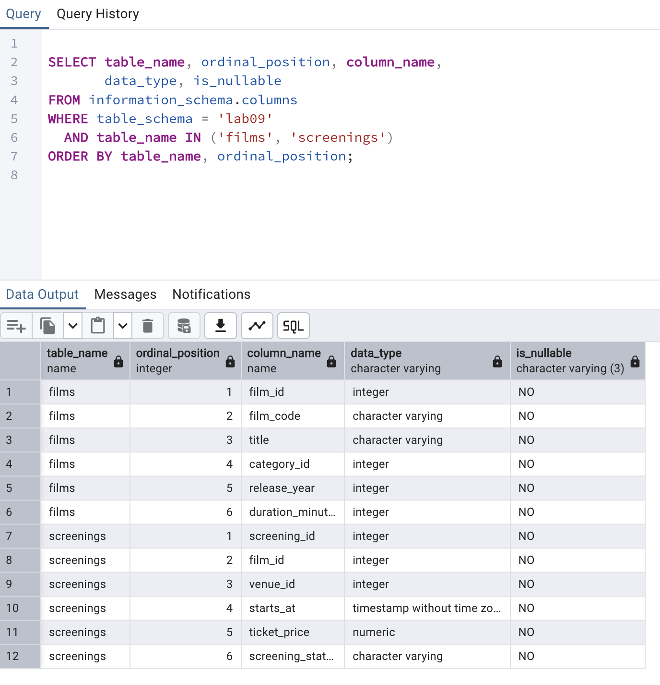
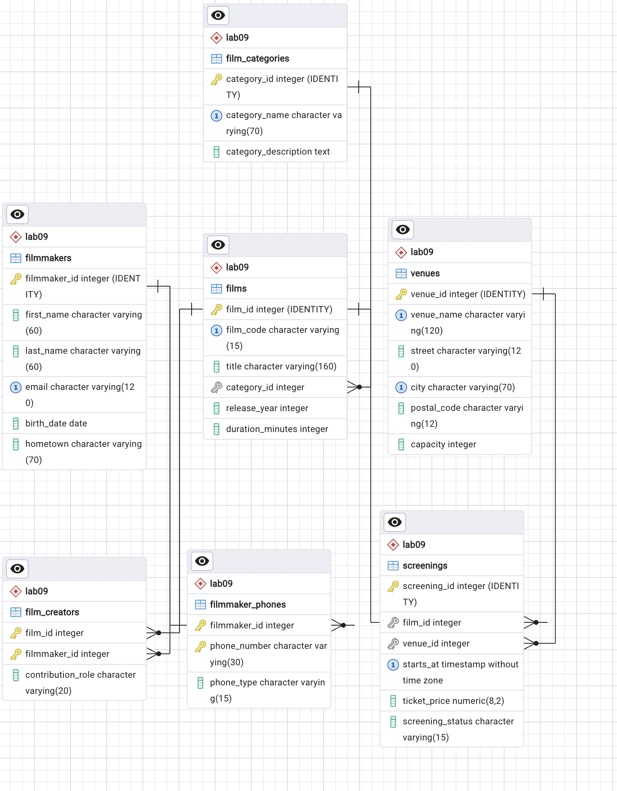

# Lab 10 — Viewing Database and Table Structure

**Course:** Database Systems  
**Student:** Aizirek Myrzabayeva  
**Environment:** PostgreSQL 18, `psql`, pgAdmin 4 on macOS  
**Existing database:** `postgres`  
**Schema reused from Lab 09:** `lab09` — Community Film Festival

## 1. Overview

This lab investigates the actual structure of the relational database designed in [Lab 09](../lab-09/README.md). Instead of creating new tables, I use PostgreSQL's `psql` meta-commands, `information_schema`, and system catalogs to inspect the seven existing film-festival tables, their column types, keys, constraints, and indexes. I also visualize the schema and its links through pgAdmin's ERD tool.

The demonstration is **read-only**: it does not `CREATE`, `ALTER`, or `DROP` anything. Before running Lab 10, Lab 09 must have been executed successfully.

## 2. Learning objectives

- List tables in a named PostgreSQL schema with `\dt`.
- Describe table columns, defaults, indexes, and constraints with `\d`.
- Query `information_schema.tables` and `information_schema.columns`.
- Retrieve constraints from `pg_constraint` and indexes from `pg_indexes`.
- Compare the live schema with the conceptual ER model created in Lab 09.
- Generate an ER diagram for **only the `lab09` schema** in pgAdmin.

## 3. Tables being inspected

The original Lab 09 design contains seven tables:

| Table | Purpose | Relevant relationship |
| --- | --- | --- |
| `filmmakers` | Film creators' identities and basic details | Parent of `filmmaker_phones` and `film_creators` |
| `filmmaker_phones` | One phone number per row | Foreign key to `filmmakers` |
| `film_categories` | Film-category descriptions | Parent of `films` |
| `films` | Film title, code, category and duration | Parent of `film_creators` and `screenings` |
| `film_creators` | Who contributed to each film | Two foreign keys; composite primary key |
| `venues` | Festival locations and capacities | Parent of `screenings` |
| `screenings` | Film screening dates, venues and prices | Two foreign keys to `films` and `venues` |

In this version, `film_creators` has primary key `(film_id, filmmaker_id)`, preventing a duplicate film–creator pair. `screenings` links a film and a venue and has an additional uniqueness rule on `(film_id, venue_id, starts_at)`.

## 4. Using PostgreSQL structure commands

The `psql-demo.sql` file demonstrates:

```sql
\dt lab09.*
\d lab09.filmmakers
\d lab09.films
\d lab09.film_creators
\d lab09.screenings
```

`\dt lab09.*` lists all tables in the existing schema. The `\d` command shows the definition of each selected table, including columns, their types, `NOT NULL`, default values, indexes, and primary- or foreign-key constraints. This provides a direct check against the Lab 09 ER model.

## 5. Inspecting system metadata with SQL

The separate [`lab10.sql`](lab10.sql) file contains the read-only SQL queries that inspect:

| Source | Information retrieved |
| --- | --- |
| `information_schema.tables` | The names of seven base tables in `lab09` |
| `information_schema.columns` | Position, type, nullability and defaults of columns in four selected tables |
| `pg_constraint` + `pg_namespace` | `PRIMARY KEY`, `FOREIGN KEY`, `UNIQUE`, and `CHECK` definitions |
| `pg_indexes` | Database-generated and explicitly created indexes |
| Aggregate counts | Total tables and foreign keys in the original model |

**Expected from the original Lab 09 schema:** **seven** base tables and **six** foreign-key constraints. These are structural expectations, not fabricated execution results. The actual values are recorded in the terminal log after execution.

## 6. How to run

From the `database-systems` repository root in VS Code Terminal:

```bash
zsh lab-10/capture_lab10.sh
```

The script executes `psql-demo.sql` and `lab10.sql` and writes the **real PostgreSQL results** to [`output/psql-session.txt`](output/psql-session.txt).

If PostgreSQL reports that the Lab 09 tables are missing, run the preceding lab first:

```bash
zsh lab-09/capture_lab09.sh
```

**Warning:** The Lab 09 setup script recreates the `lab09` schema and overwrites any contents currently in it. Do this only if you need to rebuild the earlier practice database. Lab 10 itself does not modify the database.

## 7. pgAdmin screenshots

These images must be captured from my **real local pgAdmin** session. The links will display after the PNG files have been added to `output/screenshots/`.

### Screenshot 1 — Column types and nullability

Open pgAdmin and use Query Tool connected to the `postgres` database. Run the following query, and capture the SQL and the **Data Output** panel in one screenshot:

```sql
SELECT table_name, ordinal_position, column_name,
       data_type, is_nullable
FROM information_schema.columns
WHERE table_schema = 'lab09'
  AND table_name IN ('films', 'screenings')
ORDER BY table_name, ordinal_position;
```

Save the screenshot as `output/screenshots/01-pgadmin-column-types.png`.



### Screenshot 2 — ERD of the live `lab09` schema

In pgAdmin, expand **Servers → your server → Databases → postgres → Schemas → lab09**. Right-click the **lab09** schema, then choose **ERD for Schema** (if offered in your version of pgAdmin). The resulting diagram should contain **only seven Lab 09 tables**, with their foreign-key lines. Use the ERD tool's **Auto-align** or **Zoom to fit** controls if necessary.

**Important:** Do not choose *ERD for Database* on `postgres`; that would include unrelated lab schemas. If your pgAdmin version does not show *ERD for Schema*, launch the **ERD Tool** and drag the seven Lab 09 tables onto the canvas from the Object Explorer.

Capture the ERD as a screenshot, or use the tool's image-export feature, and save it as `output/screenshots/02-pgadmin-erd.png`.



The [Lab 09 ER model](../lab-09/README.md) describes the same six foreign-key relationships. The new image above must show the **actual PostgreSQL schema**, not just the conceptual diagram used in Lab 09.

## 8. Verification and conclusion

This lab checks that the relational model in Lab 09 matches the actual PostgreSQL schema. Table introspection shows the declared keys and column types; system catalog queries list the stored constraint and index definitions. The pgAdmin ERD provides a graphical cross-check of the linked tables.

The complete execution log and screenshots are retained to make the inspection reproducible.

**Files:** [Metadata SQL](lab10.sql) · [psql demo](psql-demo.sql) · [Terminal capture script](capture_lab10.sh) · [Full session output](output/psql-session.txt)  
**References:** [Official AUCA Lab 10 course document](https://drive.google.com/file/d/10Mzs-G_WIk6rxG1QF6IywiR-CuzAKEPC/view) · [pgAdmin ERD documentation](https://www.pgadmin.org/docs/pgadmin4/latest/erd_tool.html)
