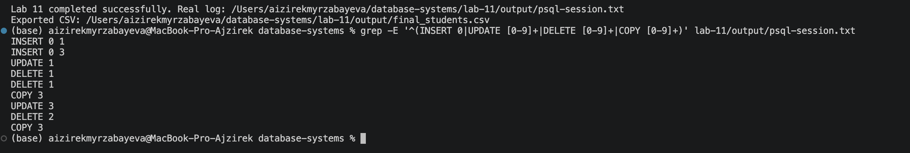
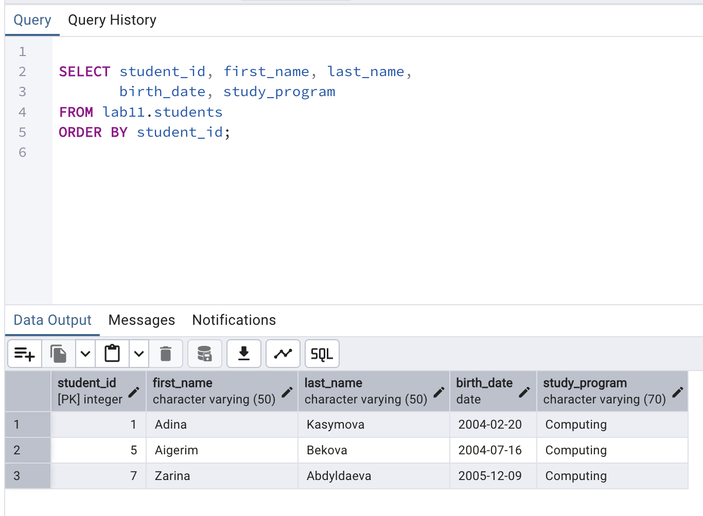

# Lab 11 — Basic Data Operations

**Course:** Database Systems (AUCA)  
**Student:** Aizirek Myrzabayeva  
**Database:** `postgres` · **Schema:** `lab11`  
**Tools:** PostgreSQL 18, `psql`, macOS, Visual Studio Code

## 1. Objective

The purpose of this laboratory is to practice the SQL data manipulation language (DML): adding records with `INSERT`, modifying them with `UPDATE`, and removing them with `DELETE`. The exercise also uses `\copy` to import and export CSV data and demonstrates safe, targeted bulk operations. `RETURNING` displays the rows affected by each modification.

## 2. Scenario and Table Design

I modeled a small, fictional **Campus Coding Club** student register. Each student has an automatically generated identifier, a first and last name, a birth date, and a study program. None of the names or dates are real student records.

The script creates a table named `lab11.students`:

| Column | Type | Purpose |
|---|---|---|
| `student_id` | `INTEGER GENERATED ALWAYS AS IDENTITY PRIMARY KEY` | Unique automatically assigned student ID |
| `first_name` | `VARCHAR(50) NOT NULL` | Required given name |
| `last_name` | `VARCHAR(50) NOT NULL` | Required family name |
| `birth_date` | `DATE` | Date of birth (optional) |
| `study_program` | `VARCHAR(70) NOT NULL` | Academic program |

The `lab11` schema isolates this exercise from the other laboratory tables. **Every rerun recreates only this schema**, so earlier Labs 1–10 are not modified. Any previous tables inside `lab11` would be replaced.

## 3. How to Run

Open a Terminal in the **root of the `database-systems` repository** and execute:

```bash
zsh lab-11/capture_lab11.sh
```

The shell script runs:

```bash
psql -X -a -v ON_ERROR_STOP=1 -P pager=off -d postgres -f lab-11/psql-demo.sql
```

It captures the **real output** into [`output/psql-session.txt`](output/psql-session.txt). The script also exports the final rows to [`output/final_students.csv`](output/final_students.csv). Both files are generated only after successful execution on the local computer; neither contains simulated results in this starter package.

> `\copy` reads and writes files on the *client computer*. PostgreSQL's SQL `COPY` accesses files on the *server*, which can require additional permissions. The relative CSV paths in this exercise assume that the shell script is run from the repository root; the provided `capture_lab11.sh` takes care of this automatically.

## 4. Data Operations

| Step | SQL command | Purpose |
|---|---|---|
| 1 | `INSERT ... VALUES (...) RETURNING *` | Add one student, Adina |
| 2 | `INSERT ... VALUES (...), (...), (...) RETURNING *` | Insert three students together |
| 3 | `UPDATE ... WHERE student_id = 1 RETURNING *` | Correct Adina's birth date without changing other records |
| 4 | `DELETE ... WHERE student_id = 4 RETURNING *` | Remove a specific student |
| 5 | `DELETE ... WHERE birth_date < '2004-01-01' RETURNING *` | Delete an older-date record using a condition |
| 6 | `\copy ... FROM 'lab-11/students.csv'` | Import three additional students from CSV |
| 7 | `UPDATE ... WHERE study_program IN (...) RETURNING` | Change three study-program labels in one operation |
| 8 | `DELETE ... WHERE student_id IN (3, 6) RETURNING` | Remove two student records together |
| 9 | `SELECT ... ORDER BY student_id` | Confirm the final records |
| 10 | `\copy (...) TO 'lab-11/output/final_students.csv'` | Export the remaining records |

The initial four students and the three imported students have original fictional data, not the values in Aidin's example. The order of the operations is intentional: some rows are deleted, the CSV import adds new rows, and the final bulk operations leave three records.

## 5. Expected Results and Verification

After a clean run, the table should contain **three remaining records**, with IDs **1, 5, and 7**. These are expected results derived from the script, not a substitute for the actual terminal output:

| student_id | first_name | last_name | birth_date | study_program |
|---:|---|---|---|---|
| 1 | Adina | Kasymova | 2004-02-20 | Computing |
| 5 | Aigerim | Bekova | 2004-07-16 | Computing |
| 7 | Zarina | Abdyldaeva | 2005-12-09 | Computing |

`RETURNING` helps confirm exactly which rows changed. The script also prints the `\dt lab11.*` and `\d lab11.students` descriptions to verify the table's final structure.

### Screenshot 1 — Data Operations in Terminal

The screenshot should show actual `INSERT`, `UPDATE`, `DELETE`, and `COPY` status messages obtained during execution.



### Screenshot 2 — Final Students in pgAdmin

The screenshot should show the `SELECT` query and the final three rows in pgAdmin's Query Tool.



### Complete Session and Export

- [Full PostgreSQL terminal session](output/psql-session.txt)
- [Imported source CSV](students.csv)
- [Exported final student CSV](output/final_students.csv)

## 6. Safety and Key Takeaways

- `WHERE` is important in both `UPDATE` and `DELETE`: without it, all rows can be affected.
- `RETURNING` gives immediate evidence of rows inserted, updated, or removed.
- Multi-row `INSERT` and CSV import provide two approaches to bulk data insertion.
- The source CSV is stored in the repository, making the example reproducible.
- Auto-generated identity values are not necessarily consecutive after deletions; gaps in IDs are normal.
- The exercise resets **only** the `lab11` schema; it does not change other lab schemas.

## 7. References

- [AUCA course document — Basic Data Operations](https://drive.google.com/file/d/1RVpvu9cB8a5DvNdprKtkErKihBPt3OMs/view)
- [PostgreSQL — Modifying Data](https://www.postgresql.org/docs/18/dml.html)
- [PostgreSQL — `psql` and `\copy`](https://www.postgresql.org/docs/18/app-psql.html)
