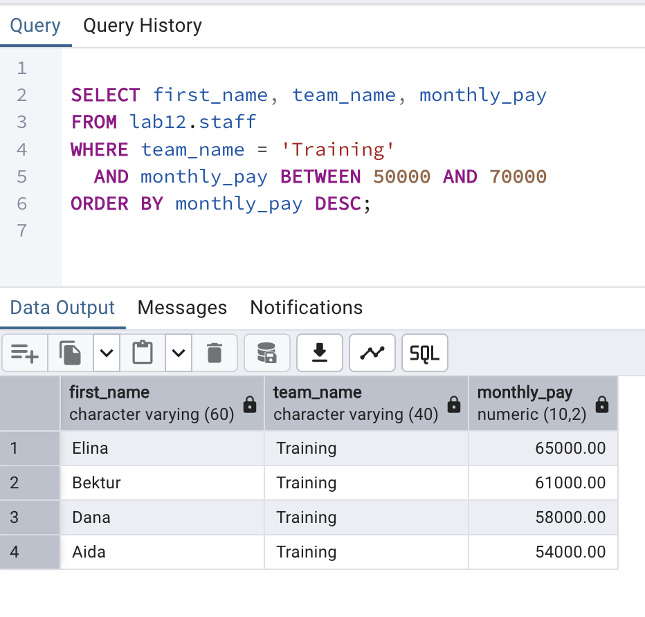
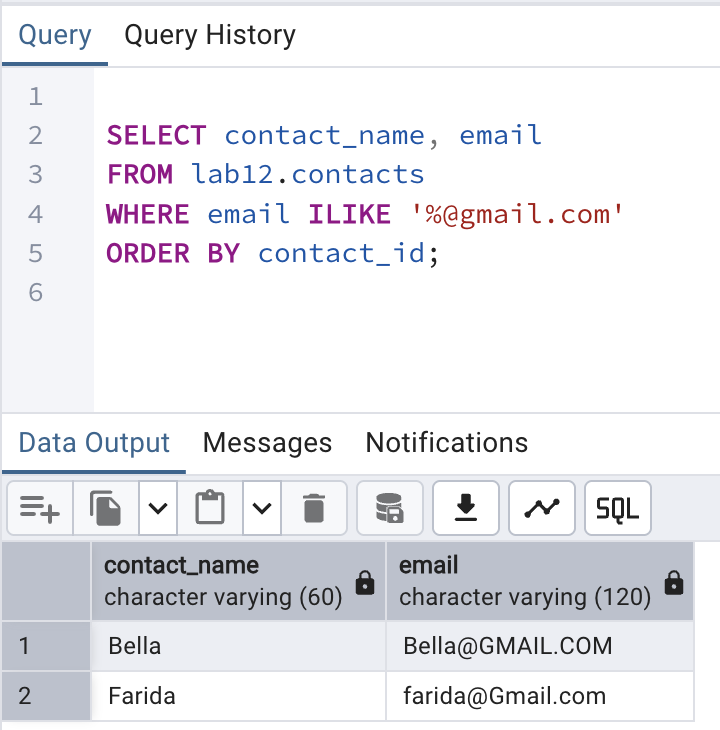
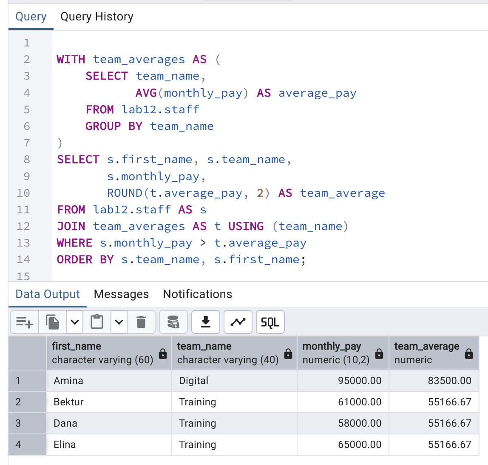

# Lab 12: Querying Data

**Student:** Aizirek Myrzabayeva  
**Course:** Database Systems · American University of Central Asia  
**DBMS:** PostgreSQL 18 · `psql` / pgAdmin 4  
**Case study:** Community Learning Center Operations (fictional data)

## 1. Overview

This laboratory explores how to retrieve and filter records with PostgreSQL. I created an independent `lab12` schema containing nine fictional staff members, five supplies, five contacts, and four recorded activity contributions. The same dataset supports simple `SELECT` statements, pattern matching, subqueries, conditional expressions, and Common Table Expressions (CTEs).

The code follows the topics in [the official course handout](https://drive.google.com/file/d/1-cihprgNppU8XEBNQh3kplBKjd1-9UPL/view). The names and values in this example are fictional, not imported from any organization.

## 2. Learning objectives

- Retrieve complete or selected columns with `SELECT` and calculate derived values using `AS`.
- Filter rows with comparisons, `AND`, `OR`, `NOT`, `BETWEEN`, and `IS NULL`.
- Match text with `LIKE`, `ILIKE`, and PostgreSQL regex operators `~`, `~*`, `!~`, and `!~*`.
- Use `IN` (both static and subquery forms), correlated `EXISTS`, and `CASE`.
- Write a CTE (`WITH`) to compare individual pay with team averages.

## 3. Example data model

| Table | Purpose | Rows inserted |
| --- | --- | ---: |
| `lab12.staff` | Staff identifiers, team, compensation, and contact information | 9 |
| `lab12.supplies` | Training supplies with categories and prices | 5 |
| `lab12.contacts` | Names and email strings for pattern matching | 5 |
| `lab12.contributions` | Staff-linked activity amounts | 4 |

`contributions.staff_id` references `staff.staff_id`. The examples deliberately include one `NULL` email and mixed-case email addresses so that null checks and case-sensitive / case-insensitive matches are observable.

## 4. How to run

From the root of the `database-systems` repository:

```bash
zsh lab-12/capture_lab12.sh
```

The shell script runs PostgreSQL with `ON_ERROR_STOP=1` and records real terminal output in [`output/psql-session.txt`](output/psql-session.txt). The underlying SQL can also be run directly:

```bash
psql -X -a -v ON_ERROR_STOP=1 -P pager=off -d postgres -f lab-12/psql-demo.sql
```

> **Rerun warning:** The script drops and recreates **only** the `lab12` schema. It will replace any existing `lab12` records but does not touch `lab01`–`lab11` or any other schema.

## 5. Query demonstrations

### 5.1 SELECT, aliases, and calculations

`SELECT *` returns complete records. Selecting only `first_name` and `team_name` produces a narrower report. A computed expression illustrates column aliases:

```sql
SELECT first_name, monthly_pay,
       ROUND(monthly_pay * 0.10, 2) AS estimated_bonus
FROM lab12.staff
ORDER BY staff_id;
```

This calculation displays a hypothetical 10% bonus; it does not update any stored values.

### 5.2 WHERE, comparisons, and nulls

| Operator | Example | Meaning |
| --- | --- | --- |
| `=` | `team_name = 'Training'` | Equal value |
| `>`, `<>` | `monthly_pay > 70000`, `monthly_pay <> 65000` | Comparison and inequality |
| `AND`, `OR`, `NOT` | Multiple predicates | Combine or negate conditions |
| `BETWEEN` | `unit_cost BETWEEN 1000 AND 3000` | Inclusive lower and upper bounds |
| `IS NULL` | `email IS NULL` | Find missing values |
| `IS NOT NULL` | `email IS NOT NULL` | Find available values |

The following screenshot query selects Training staff with pay between 50,000 and 70,000:

```sql
SELECT first_name, team_name, monthly_pay
FROM lab12.staff
WHERE team_name = 'Training'
  AND monthly_pay BETWEEN 50000 AND 70000
ORDER BY monthly_pay DESC;
```

**Expected result:** Elina, Bektur, Dana, and Aida (four rows, based on the provided seed data).

### 5.3 LIKE, ILIKE, and regular expressions

| Pattern/operator | Use |
| --- | --- |
| `LIKE 'Be%'` | Starts with `Be` (case-sensitive) |
| `LIKE '%light'` | Ends in `light` |
| `LIKE 'B_l%'` | `_` matches one character |
| `ILIKE '%@gmail.com'` | Case-insensitive Gmail domain search |
| `~ '^[AB]'` | Regex beginning with `A` or `B` |
| `~*` | Case-insensitive regex match |
| `!~` and `!~*` | Negated regex matching |

The email pattern in the SQL script is **illustrative only**, not a complete email address validator.

### 5.4 IN, EXISTS, CASE, and CTEs

`IN` with a subquery and correlated `EXISTS` both identify staff with contributions greater than 1,000. `CASE` classifies fictional pay into `Lead`, `Specialist`, and `Associate` bands without changing stored values.

The CTE calculates average pay for each team and returns staff earning **above their own team's average**:

```sql
WITH team_averages AS (
    SELECT team_name, AVG(monthly_pay) AS average_pay
    FROM lab12.staff GROUP BY team_name
)
SELECT s.first_name, s.team_name, s.monthly_pay,
       ROUND(t.average_pay, 2) AS team_average
FROM lab12.staff AS s
JOIN team_averages AS t USING (team_name)
WHERE s.monthly_pay > t.average_pay
ORDER BY s.team_name, s.first_name;
```

**Expected result:** Amina (Digital), Bektur, Dana, and Elina (Training): four rows based on the provided seed data. The Support team has one staff member, so none is strictly above that team's average.

## 6. Results and screenshots

The following images must be captured from a **successful execution on the local PostgreSQL installation**. They are not included as simulated screenshots.

### 6.1 Filtering and BETWEEN



Run the following in pgAdmin's Query Tool (connected to the `postgres` database):

```sql
SELECT first_name, team_name, monthly_pay
FROM lab12.staff
WHERE team_name = 'Training'
  AND monthly_pay BETWEEN 50000 AND 70000
ORDER BY monthly_pay DESC;
```

Capture **the SQL statement and the Data Output grid** together as `01-where-and-between.png`.

### 6.2 Case-insensitive pattern matching



```sql
SELECT contact_name, email
FROM lab12.contacts
WHERE email ILIKE '%@gmail.com'
ORDER BY contact_id;
```

Expected matches: Bella and Farida. Capture as `02-ilike-matches.png`.

### 6.3 CTE team averages



Run the CTE from Section 5.4 in pgAdmin. Capture the query and its four result rows as `03-cte-team-averages.png`.

**Full unedited terminal output:** [output/psql-session.txt](output/psql-session.txt)

## 7. Observations and conclusion

The designed exercises distinguish row filtering from pattern searching and from nested-query logic. Inclusive ranges, case-sensitive text matches, and three-valued `NULL` logic can change query results substantially. `IN` and `EXISTS` express two ways to identify contributors, while a CTE breaks a multi-step aggregate comparison into readable parts.

After execution, the screenshots and raw `psql` log should document the actual results rather than merely the intended SQL.

## 8. References

- [AUCA course document: Querying Data](https://drive.google.com/file/d/1-cihprgNppU8XEBNQh3kplBKjd1-9UPL/view)
- [PostgreSQL 18 documentation: SELECT](https://www.postgresql.org/docs/18/sql-select.html)
- [PostgreSQL 18 documentation: Pattern Matching](https://www.postgresql.org/docs/18/functions-matching.html)
- [PostgreSQL 18 documentation: WITH Queries](https://www.postgresql.org/docs/18/queries-with.html)
