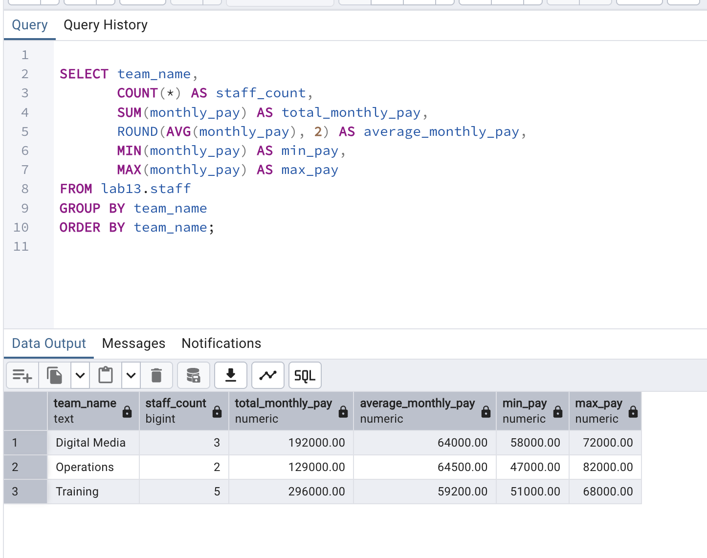
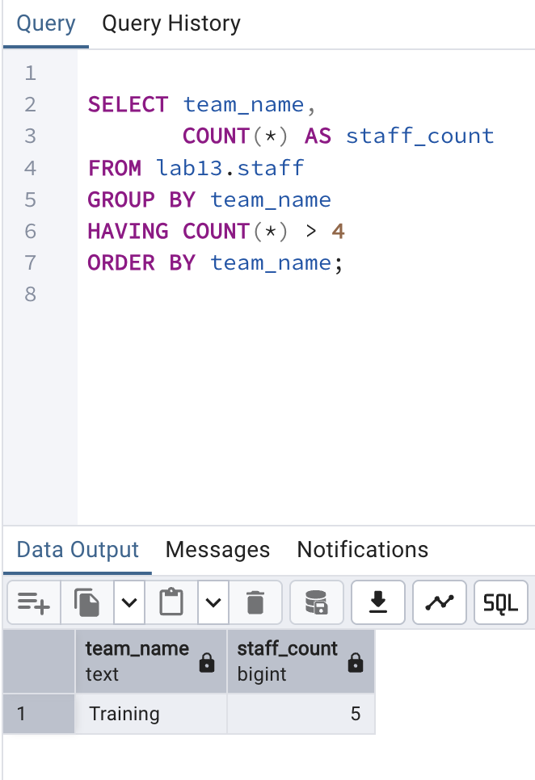
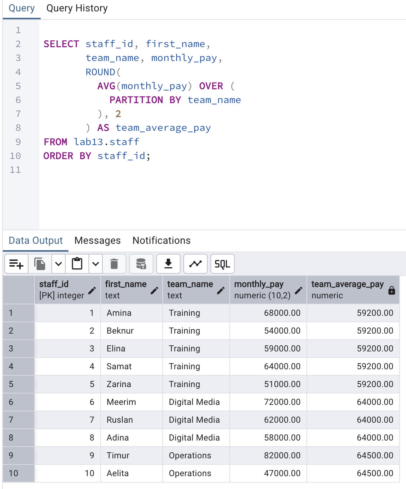

# Lab 13 — Aggregate Functions

**Course:** Database Systems · **Student:** Aizirek Myrzabayeva  
**Environment:** PostgreSQL 18 / `psql` / pgAdmin 4 (macOS)  
**Scenario:** Fictional Community Learning Center staff, workshops, skills, and activity payments.

## Objective

Explore how PostgreSQL aggregate functions summarize multiple records, how `GROUP BY` creates groups, and how `HAVING` filters aggregate results. Examine `NULL` behavior, statistical summaries, ordered string and array aggregation, conditional counts, percentages, and window aggregates.

## Data Model

All data is fictional and lives in the isolated PostgreSQL schema **`lab13`**.

| Table | Contents |
| --- | --- |
| `staff` | 10 staff members across Training (5), Digital Media (3), and Operations (2) |
| `workshops` | 4 learning workshops and their categories and fees |
| `activity_payments` | 7 recorded payments connected to staff members |
| `staff_skills` | Multiple skills for each staff member |
| `workshop_reviews` | Ratings used to demonstrate grouped `HAVING` conditions |

The staff data intentionally has one missing email and some `NULL` bonuses. All names, addresses, fees, and payments are educational examples rather than real organizational records.

## Execution

From the root of the `database-systems` repository:

```bash
zsh lab-13/capture_lab13.sh
```

Or execute the psql demonstration directly:

```bash
psql -X -a -v ON_ERROR_STOP=1 -P pager=off -d postgres -f lab-13/psql-demo.sql
```

The capture script writes the actual PostgreSQL output to [output/psql-session.txt](output/psql-session.txt). **Re-running recreates only schema `lab13`**; it does not modify previous labs.

## Aggregate Queries and Results

| Topic | Query technique | What to verify |
| --- | --- | --- |
| Counting | `COUNT(*)`, `COUNT(email)`, `COUNT(DISTINCT team_name)` | 10 staff, 9 non-NULL emails, 3 teams |
| Summary | `SUM`, `AVG`, `MIN`, `MAX` | Total monthly pay of 617,000 (fictional currency units) |
| Team grouping | `GROUP BY team_name` | Separate totals and averages per team |
| Payment totals | `SUM(amount)` after joining staff | Payments grouped by team |
| Names and arrays | `STRING_AGG`, `ARRAY_AGG` | Ordered names and pay lists |
| Statistics | `STDDEV`, `VARIANCE`, `CORR` | Pay spread and experience/pay correlation |
| Calendar grouping | `EXTRACT(YEAR/QUARTER ...)` | Payments by year and quarter |
| Calculated grouping | `CASE ... GROUP BY` | Pay summary by age band |
| Group filters | `HAVING COUNT(*) > 4` | Training is the only team returned |
| Review quality | `HAVING AVG(rating) > 4 AND COUNT(*) >= 3` | Digital Safety and Python Foundations qualify |
| Row and group filters | `WHERE` followed by `HAVING` | Filter recent hires before checking team counts |
| Window aggregates | `AVG(...) OVER (PARTITION BY team_name)` | 10 individual rows, with each team average repeated |
| `NULL` handling | `COUNT(bonus)`, `SUM(bonus)`, `AVG(bonus)` | Missing bonuses excluded; zero bonuses counted |
| Conditional aggregates | `COUNT(*) FILTER (WHERE ...)` | Team-level counts and percentages |
| Multi-column groups | `GROUP BY team_name, EXTRACT(YEAR ...)` | Counts of hires by team and year |

### `WHERE` vs `HAVING`

`WHERE` filters individual records **before** grouping. `HAVING` filters groups **after** `GROUP BY` and can use conditions on aggregates such as `COUNT(*)` or `AVG(rating)`.

### Aggregate functions vs window functions

`AVG(monthly_pay)` with `GROUP BY team_name` produces one result per team. `AVG(monthly_pay) OVER (PARTITION BY team_name)` shows each person's pay beside the team's average without collapsing the original rows.

### Understanding `NULL`

`COUNT(*)` counts every record, whereas `COUNT(email)` counts only non-NULL email values. `SUM` and `AVG` exclude `NULL`; a numeric `0` is included in both calculations.

## Results and Screenshots

The image files below must be captured from the real local PostgreSQL session before submission; placeholders are not presented as completed evidence.

### 1. Team aggregates

Totals and averages of monthly pay by team:

```sql
SELECT team_name, COUNT(*) AS staff_count,
       SUM(monthly_pay) AS total_monthly_pay,
       ROUND(AVG(monthly_pay), 2) AS average_monthly_pay,
       MIN(monthly_pay) AS min_pay,
       MAX(monthly_pay) AS max_pay
FROM lab13.staff
GROUP BY team_name
ORDER BY team_name;
```



### 2. `HAVING` condition

The team having more than four staff members:

```sql
SELECT team_name, COUNT(*) AS staff_count
FROM lab13.staff
GROUP BY team_name
HAVING COUNT(*) > 4
ORDER BY team_name;
```



### 3. Window average

Staff pay compared with each team's average:

```sql
SELECT staff_id, first_name, team_name, monthly_pay,
       ROUND(AVG(monthly_pay) OVER (PARTITION BY team_name), 2)
           AS team_average_pay
FROM lab13.staff
ORDER BY staff_id;
```



See the complete saved execution log: [psql-session.txt](output/psql-session.txt).

## Conclusion

This lab demonstrates row counting, numerical and statistical aggregation, text and array aggregation, grouping, conditional and percentage calculations, `HAVING`, and window functions. The SQL file provides repeatable examples. Actual execution results and screenshots should be verified on the local PostgreSQL server before submission.

## References

- [AUCA course handout — Aggregate Functions](https://drive.google.com/file/d/1CU4xZzAL52Sm0nzcEufCutvlu2C2Z2Yi/view)
- [PostgreSQL: Aggregate Functions](https://www.postgresql.org/docs/18/functions-aggregate.html)
- [PostgreSQL: Window Functions](https://www.postgresql.org/docs/18/tutorial-window.html)
