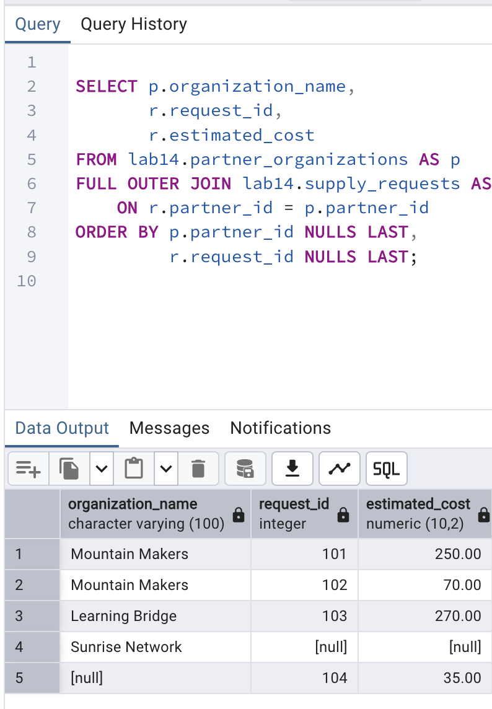
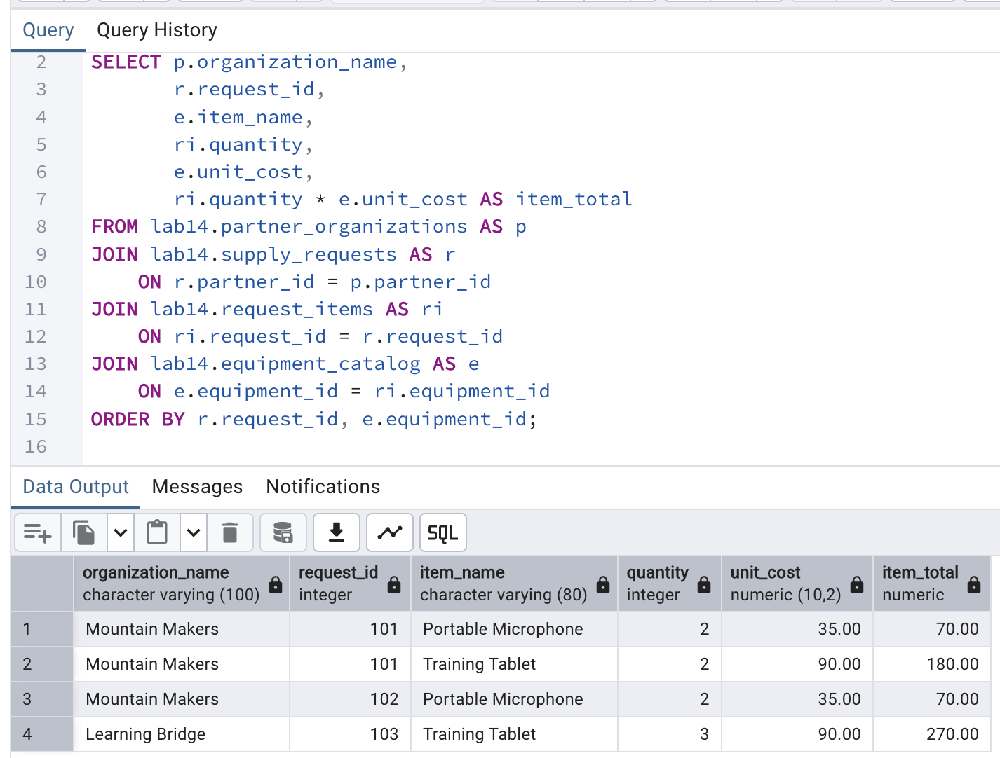
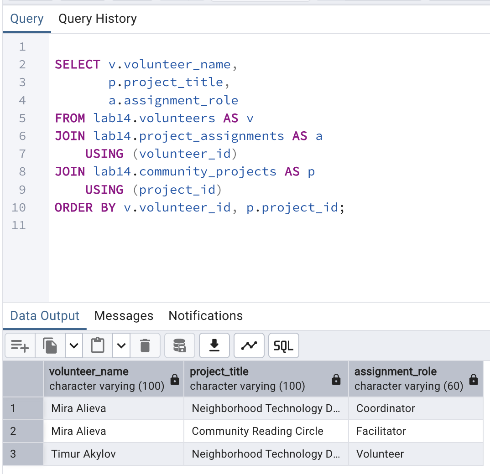

# Lab 14: Joining Tables

**Course:** Database Systems  
**Student:** Aizirek Myrzabayeva  
**DBMS:** PostgreSQL 18 / `psql`  
**Example:** *Community Equipment & Workshops* (fictional dataset)

## Overview

I designed a small community-workshop database and demonstrated how SQL joins combine related rows. Three partner organizations submit equipment requests; one partner has no requests, and one request comes from an unregistered guest (`partner_id IS NULL`). These intentionally unmatched rows make the differences between join types visible.

All example objects are kept inside the `lab14` schema. **Rerunning the script drops and recreates only that schema**, not the schemas belonging to earlier labs. No actual community or participant data is used.

## Learning objectives

- Compare `INNER`, `LEFT`, `RIGHT`, `FULL OUTER`, and `CROSS JOIN`.
- Write multi-table queries, self joins, and filtered joins.
- Demonstrate one-to-one, one-to-many, and many-to-many relationships.
- Use a junction table with foreign keys and a composite primary key.
- Identify unmatched records with outer joins and `IS NULL`.
- Inspect join indexes and a query plan using `EXPLAIN (ANALYZE, BUFFERS)`.

## Setup and execution

From the root of the `database-systems` repository:

```bash
zsh lab-14/capture_lab14.sh
```

The shell script runs `psql-demo.sql`, which includes `lab14.sql`, and saves the actual console output in [`output/psql-session.txt`](output/psql-session.txt).

You can also run PostgreSQL directly:

```bash
psql -X -a -v ON_ERROR_STOP=1 -P pager=off -d postgres -f lab-14/psql-demo.sql
```

## Join types and observed design

The sample data includes 3 partners and 4 equipment requests; two requests belong to Mountain Makers, one to Learning Bridge, one is a guest request, and Sunrise Network has no requests. The following row counts are **expected** before running the lab:

| SQL join | Expected rows | Meaning |
| --- | ---: | --- |
| `INNER JOIN` | 3 | Only matched partners and requests |
| `LEFT JOIN` | 4 | All partners, including Sunrise Network |
| `RIGHT JOIN` | 4 | All requests, including guest request 104 |
| `FULL OUTER JOIN` | 5 | Matched rows plus both unmatched cases |
| `CROSS JOIN` | 6 | Three partners multiplied by two equipment items |

A foreign key may be nullable. Here, `partner_id = NULL` allows a guest request while invalid non-NULL references are still disallowed.

## Advanced joins

**Four-table join.** The query joins `partner_organizations`, `supply_requests`, `request_items` (a junction table), and `equipment_catalog`. It displays equipment quantities, unit prices, and calculated line totals. The example returns **4 matched line items**; the guest request is excluded by the `INNER JOIN`.

**Self join.** `team_members` references itself through `supervisor_id`. A `LEFT JOIN` retains the program director even though the director has no supervisor.

**Join conditions.** Adding `WHERE estimated_cost > 100` and a date condition filters the joined requests down to **2**.

## Relationship types

| Relationship | Example | Design |
| --- | --- | --- |
| 1:1 | Partner ↔ Profile | `partner_profiles.partner_id` is both a primary key and foreign key |
| 1:N | Trainer → Training sessions | `training_sessions.trainer_id` references `trainers` |
| N:M | Volunteers ↔ Community projects | `project_assignments` has two foreign keys and a composite primary key |

The many-to-many query is expected to display **3 assignments**. It is not correct to join volunteers directly to projects without the `project_assignments` junction table.

## Indexes, performance, and pitfalls

Indexes are created for `supply_requests.partner_id` and `request_items.equipment_id`. The composite primary key on `request_items(request_id, equipment_id)` already provides an index whose leading column is `request_id`.

The `EXPLAIN (ANALYZE, BUFFERS)` section displays the PostgreSQL planner's actual choice. On such a small dataset, PostgreSQL may still prefer a sequential scan: an index does **not** guarantee that the planner uses it.

I used short table aliases and explicit join predicates to avoid unintended Cartesian products. `CROSS JOIN` is deliberately used only for the 3 × 2 demonstration. Outer joins require attention to `NULL` when identifying unmatched records.

## Screenshots and output

The following images must be captured from my **actual local PostgreSQL results** after executing the lab. The links will display on GitHub when the files are added.

### 1. Full outer join and unmatched rows



### 2. Multi-table join



### 3. Many-to-many join



**Full execution log:** [output/psql-session.txt](output/psql-session.txt)

## Conclusion

This lab demonstrates how join choice changes which rows are kept in a result. A full join preserves unmatched records on both sides; multi-table and many-to-many queries reconstruct normalized relationships; and self joins reveal hierarchical information. The SQL script can be re-run to verify these cases with the same fictional sample records.

**Course document:** [Joining Tables — Official Lab 14](https://drive.google.com/file/d/1LxE7hZ0vhc3xIfryMtvSnM64u8A0xoH0/view)
