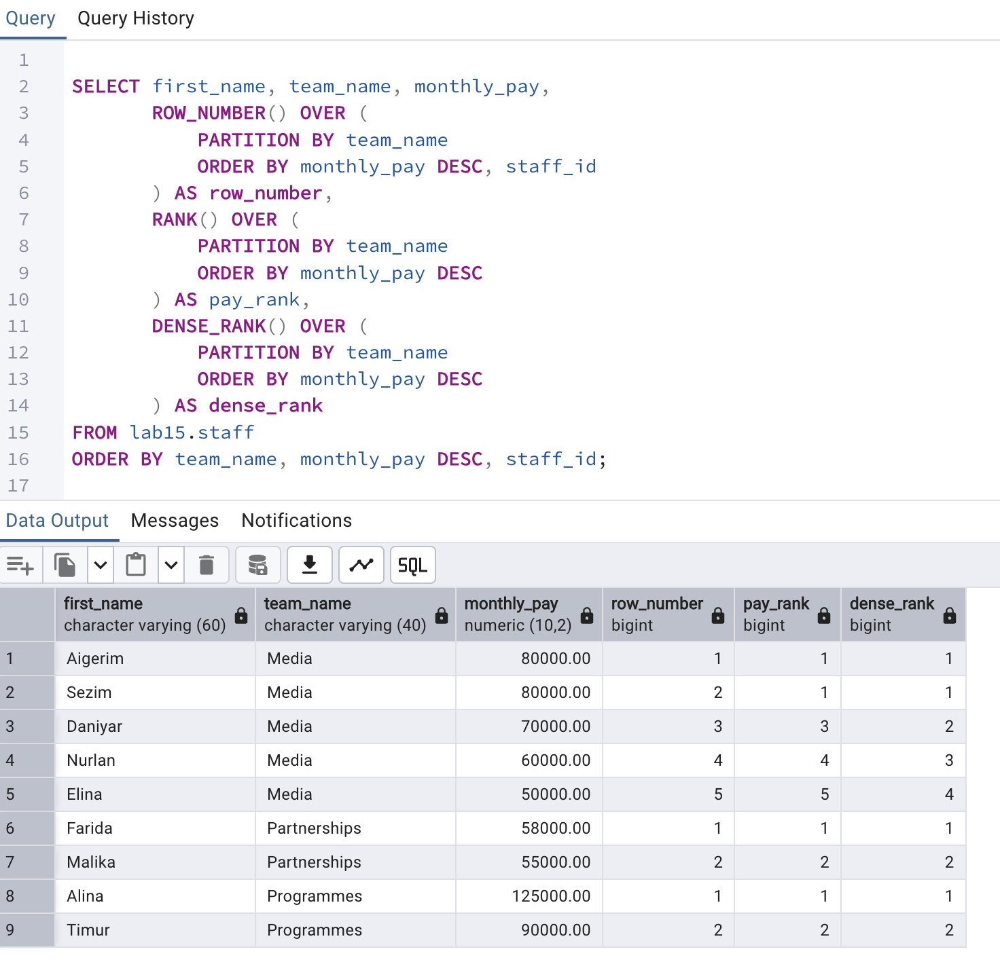
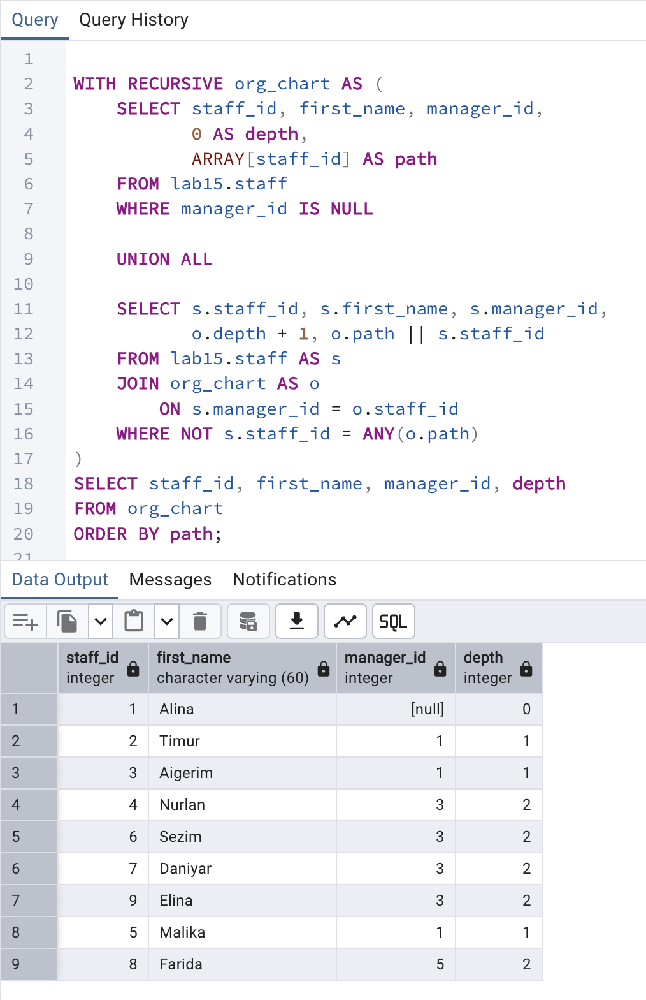
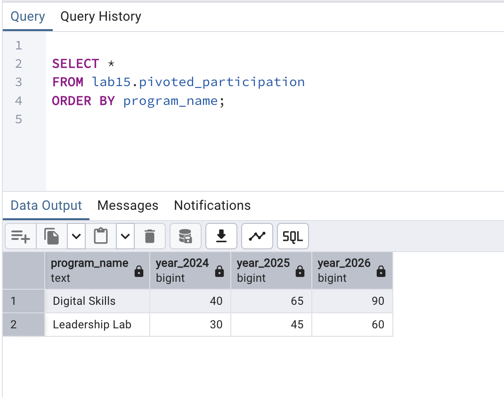

# Lab 15: Advanced Querying

**Course:** Database Systems · **Student:** Aizirek Myrzabayeva  
**Environment:** PostgreSQL 18, `psql`, macOS · **Case study:** Youth Innovation Program Operations (fictional data)

## Overview

This lab demonstrates advanced SQL techniques using an isolated `lab15` schema. The sample database contains nine team members in **Programmes**, **Media**, and **Partnerships**; a manager–staff hierarchy; four contributions; overlapping equipment inventories; and annual program participation records.

The goal is to ask more complex questions without changing the underlying model: compare rows with subqueries, follow organizational relationships recursively, combine result sets, analyze data while preserving detail rows, and reshape reports for presentation.

## Learning objectives and evidence

| Technique | Demonstration |
| --- | --- |
| Scalar, row, and table subqueries | Pay above the global average; staff sharing Aigerim's team and pay; team-average subquery |
| Common table expression (`WITH`) | Contributions grouped by team |
| Recursive CTE (`WITH RECURSIVE`) | Nine-member reporting hierarchy with an explicit traversal path |
| `UNION`, `UNION ALL`, `INTERSECT`, `EXCEPT` | Two partially overlapping equipment inventories |
| Window functions | `ROW_NUMBER`, `RANK`, `DENSE_RANK`, `LAG`, `LEAD`, running `SUM` |
| `FILTER` and `OVER` | Average pay for staff with over five years' experience without collapsing rows |
| Pivot / unpivot | Two programs across 2024–2026, converted to columns and back |
| Custom sorting | Priority order High → Medium → Low using `CASE` |
| Performance | Composite index, `ANALYZE`, `EXPLAIN`, and `EXPLAIN (ANALYZE, BUFFERS)` |

## Database design

The main `staff` table has a **self-referencing foreign key** (`manager_id` → `staff_id`) to model reporting relationships. Two staff members in the Media team have the same monthly pay, making it possible to observe the different ranking functions.

The supporting tables are `contributions`, `storage_a`, `storage_b`, `annual_participation`, and `program_tasks`. A view named `pivoted_participation` summarizes annual records.

All names use lowercase `snake_case`. Values, names, emails, and contribution amounts are invented solely for this exercise.

## Running the laboratory

From the root of the `database-systems` repository:

```bash
zsh lab-15/capture_lab15.sh
```

The shell script runs `psql-demo.sql`, which loads `lab15.sql`, and writes the **actual** PostgreSQL output to [`output/psql-session.txt`](output/psql-session.txt).

You can also run the SQL directly:

```bash
psql -X -a -v ON_ERROR_STOP=1 -P pager=off -d postgres -f lab-15/psql-demo.sql
```

> **Rerun behavior:** `lab15.sql` drops and recreates **only** the `lab15` schema. Anything already stored in that schema will be replaced. Other laboratory schemas are not touched.

## Key results to verify

| Operation | Expected result in the sample dataset |
| --- | --- |
| Salary above overall average | Four staff members |
| Row comparison with Aigerim | Aigerim and Sezim (same team and pay) |
| Recursive organization chart | Nine staff members, depths 0–2 |
| `UNION` / `UNION ALL` | Three distinct equipment names / four rows including a duplicate |
| `INTERSECT` / `EXCEPT` | Camera Kit / Wireless Microphone |
| Media ranking | Aigerim and Sezim tie at rank 1; next rank is 3, dense rank 2 |
| Pivot / unpivot | Two program rows / six annual records |
| Running payroll total | Final cumulative pay: **668,000.00** |

`ROW_NUMBER` gives every row a different position; `RANK` uses the same rank for ties and leaves gaps; `DENSE_RANK` does not leave gaps. `LAG` and `LEAD` inspect adjacent rows within an explicit ordering. The running `SUM` uses a `ROWS` frame so that each row contributes exactly once to the cumulative amount.

`EXPLAIN` estimates query execution without running the SELECT. `EXPLAIN ANALYZE` executes the SELECT and reports measured performance. On this small dataset PostgreSQL may prefer a sequential scan even though an index exists. Query timings and plans are **not fixed** across computers.

## Results and screenshots

### 1. Window-function rankings

Compare row numbers and ranking values where monthly pay is tied.



### 2. Recursive organizational hierarchy

The recursive CTE starts from the director and visits team members by reporting line.



### 3. Pivoted annual participation

Conditional aggregation produces a compact report with one column per year.



The same view is unpivoted back into six annual rows with `UNION ALL`. Both sets of results are saved in the [full terminal session](output/psql-session.txt).

> Screenshots are added after executing the queries in the local PostgreSQL installation. They are not simulated output.

## What I learned

Subqueries are useful for comparing one result with another, while CTEs clarify multi-step reporting logic. Recursive CTEs navigate hierarchies, set operators compare datasets, and window functions preserve row-level detail. Pivoting makes a time-series report easier to read, while unpivoting restores the original row representation. `EXPLAIN` and indexes provide a foundation for evaluating query plans.

## Files and references

- [SQL queries](lab15.sql)
- [psql entry script](psql-demo.sql)
- [Terminal capture script](capture_lab15.sh)
- [Full terminal output](output/psql-session.txt) — generated after running the lab
- [Official course document: Advanced Querying](https://drive.google.com/file/d/1gU37bli-KJzA6MgdamHLFV24tYdpaHL8/view)
- [PostgreSQL window functions documentation](https://www.postgresql.org/docs/18/tutorial-window.html)
