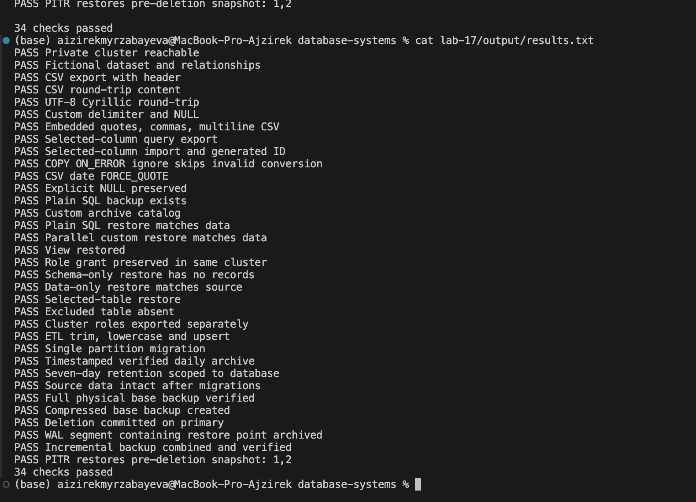
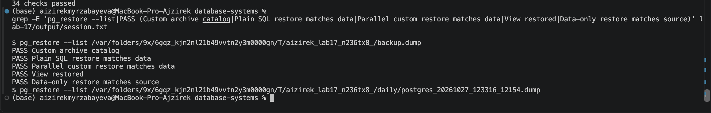

# Lab 17 — Data Import, Export and Backup

**Student:** Aizirek Myrzabayeva  
**Course:** Database Systems · AUCA  
**PostgreSQL:** 18.x · macOS · Python 3  
**Scenario:** *Community Media Studio* (fictional database)

## Overview

This laboratory demonstrates how PostgreSQL data can be exported, imported, backed up, restored, and migrated. It uses a small original relational dataset: community-media participants, programs, feedback, equipment products, and partitioned sales. The important result is **restoration verification**, not merely creating a backup file.

The official course document covers `COPY`, CSV formatting, `pg_dump`/`pg_restore`, schema/data-only backups, server-wide backups, automated retention, WAL and base backups, PITR, and migration/replication methods. This submission demonstrates many of these directly and explains the more advanced operations separately. All recorded results must come from running the demo locally, not from prewritten PASS messages.

**Important:** The program creates a private, disposable PostgreSQL 18 cluster with a UNIX socket in a temporary directory. TCP connections are disabled. It **never targets your existing `postgres` server**, and it does **not** stop or change your Homebrew PostgreSQL service. Only files inside its private temporary directory are deleted during cleanup. The two output logs remain in this lab folder.

## 1. Requirements and safety

- macOS with Python 3 and PostgreSQL **18** command-line tools (`initdb`, `pg_ctl`, `psql`, `pg_dump`, `pg_restore`, `pg_dumpall`, `createdb`).
- The optional `--full` run additionally requires `pg_basebackup`, `pg_verifybackup`, `pg_combinebackup`, and `pg_archivecleanup`.
- Approximate disk-space checks: at least **600 MB free** for the default demo and **2 GB free** for the full physical-backup run. Real usage can vary.
- Run as your normal user, **not** with `sudo` or as `root`.
- The demo intentionally uses local socket authentication only in its private sandbox; this is for the lab, **not** for production servers.
- The normal server and other labs are never used. All records are fictional.

If PostgreSQL 18 tools are not on your `PATH` on a Homebrew installation:

```bash
export PATH="$(brew --prefix postgresql@18)/bin:$PATH"
```

Check the tools without starting any server:

```bash
python3 lab-17/demo.py --check-tools
```

## 2. Execution

Run from the repository root:

```bash
zsh lab-17/capture_lab17.sh
```

Or run the equivalent Python command:

```bash
python3 lab-17/demo.py
```

**Optional — more advanced backup/recovery exercises:**

```bash
zsh lab-17/capture_lab17.sh --full
```

The full mode makes and verifies physical base backups, creates a compressed backup, *attempts* PostgreSQL 18 incremental backup/combination, and performs a point-in-time recovery to a named restore point using only temporary clusters. Incremental backup can be marked `SKIP` if the required WAL summaries are not ready; skipped tests are **not** counted as passed. This mode uses more disk space than the core run.

## 3. COPY and CSV results

The default demo performs genuine PostgreSQL client-side `\copy` operations and validates:

| Exercise | Verification |
|---|---|
| Round-trip CSV | Importing the export produces no differing rows (`EXCEPT ALL`) |
| UTF-8 data | The Cyrillic first name **Айпери** survives export/import |
| Custom CSV delimiter | `;` separator and an explicit `MISSING` NULL marker |
| Special characters | Embedded commas, quotes, and multiline feedback round-trip correctly |
| Query export | Export only participants in the Digital Storytelling program |
| Selected columns | PostgreSQL generates `IDENTITY` values for imported names |
| Invalid number | `COPY ... ON_ERROR ignore` skips a conversion failure |
| `FORCE_QUOTE` | Date values are quoted as CSV fields |

**Server-side `COPY` vs. client-side `\copy`:** SQL `COPY ... TO '/path'` accesses the PostgreSQL server's filesystem. The `psql` `\copy` command transfers data through the client, using paths accessible to the user's Terminal. In this lab we use `\copy` to avoid changing permissions or accessing the normal server filesystem. `ON_ERROR ignore` addresses input **type-conversion** failures, not arbitrary constraint violations.

## 4. Logical backups, migration, and validation

The Python demo runs PostgreSQL tools and verifies each step:

- Plain SQL backup with `pg_dump --no-owner`, then restore through `psql`.
- Custom-format archive (`pg_dump -Fc`), inspection via `pg_restore --list`, and parallel restore with `pg_restore -j 2 --no-owner`.
- Separate **schema-only** and **data-only** restoration, including checking that the schema-only database is empty.
- Restore of a **selected table** and a dump excluding a disposable audit log.
- Export of server-wide **role definitions** using `pg_dumpall --globals-only`. Note that a normal `pg_dump` does not contain cluster role definitions.
- Comparison of record counts and deterministic data digests after restore; also verification of a restored view and grant.
- CSV staging and ETL: trim spaces, normalize email case, insert/update target records using `ON CONFLICT`.
- Migration of one PostgreSQL **partition**, after preparing the parent table at the destination.
- A timestamped custom-format archive created by [`backup.sh`](backup.sh). Its cleanup is limited to the **requested database's** old `.dump` files inside a provided sandbox folder.

### Why separate backups from replication?

Logical backups are useful for portable schema/data restores and migration. Physical backups copy the PostgreSQL cluster and must be accompanied by the necessary WAL records for PITR. Replication continuously propagates data **and unwanted changes**, so it is not a replacement for a recoverable backup.

## 5. Physical backups and PITR (`--full`)

The optional mode uses:

1. `pg_basebackup -X stream` to create a full base backup, verified with `pg_verifybackup`.
2. `pg_basebackup -Ft -z` to generate a compressed tar-format base backup.
3. PostgreSQL 18 incremental backup with `--incremental`, `pg_combinebackup`, and `pg_verifybackup`, if WAL summaries are ready.
4. `archive_mode`, `archive_command`, and `pg_switch_wal()` to archive WAL for the private server.
5. A `recovery.signal` file **only in a disposable restored data directory**, with `restore_command` and `recovery_target_name` set in `postgresql.conf`.
6. A recovery check showing that a deleted row is present again at the named restore point.

PostgreSQL's `pg_basebackup -X stream` replaces the legacy `-x` example in the handout. In modern versions, recovery settings belong in PostgreSQL configuration; `recovery.signal` is an empty marker file. PostgreSQL 18 incremental base backups are distinct from ordinary WAL archiving.

The separate **logical and physical replication** exercises in the course are described here conceptually rather than being reported as automated PASS checks. Logical replication normally requires a publication, subscription, replication permissions, and matching target tables; it does not automatically copy schema changes or sequence state. Physical streaming needs a compatible server and safe cutover planning. This project avoids presenting unperformed replication tests as completed.

## 6. Results: actual logs

When you execute the demo, it writes:

- **[Results summary](output/results.txt)** — the exact PASS / FAIL / SKIP lines produced during your run.
- **[Full SQL/CLI session](output/session.txt)** — each command and its recorded stdout/stderr, including restore verification.

Neither file is supplied with invented results. If the run fails, the summary reports the failure rather than claiming a successful lab.

### Optional screenshots

Two screenshots are helpful but are not required by the source handout:

**Screenshot 1 — PASS summary:** Capture the final checks visible in Terminal or `output/results.txt`; save it as `output/screenshots/01-verified-results.png`.

**Screenshot 2 — Backup/restore evidence:** Capture the section of `output/session.txt` showing `pg_restore --list` and successful restore verification; save it as `output/screenshots/02-restoration-proof.png`.

If you captured these screenshots, uncomment the image links below:

<!--  -->
<!--  -->

## 7. Summary

A PostgreSQL backup is not validated simply because a `.dump` file was produced. A reproducible backup process checks archive readability, restores the data to an independent environment, and compares restored records with the source. The isolated lab also illustrates when logical dumps, base backups, WAL archiving, and migration strategies are appropriate.

**Source materials:** [Official Lab 17 — Data Import/Export and Backup](https://drive.google.com/file/d/1qLJkCgDSG3LaymACkhLxd_r6B5nqHRmU/view) · [PostgreSQL COPY](https://www.postgresql.org/docs/18/sql-copy.html) · [pg_dump](https://www.postgresql.org/docs/18/app-pgdump.html) · [pg_basebackup](https://www.postgresql.org/docs/18/app-pgbasebackup.html) · [pg_combinebackup](https://www.postgresql.org/docs/18/app-pgcombinebackup.html) · [WAL & PITR](https://www.postgresql.org/docs/18/continuous-archiving.html)
